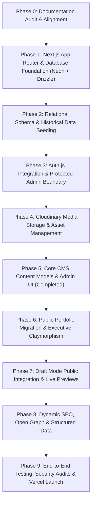

# Phased Implementation Roadmap
## Full Portfolio CMS & Next.js Architecture Evolution

**Document Version:** 2.6.0  
**Phase:** Phase 12: Production Verification, Search Readiness & Final Portfolio QA (Completed)  
**Date:** October 2026  
**Status:** Phase 12 Complete & Verified (Live production network audit executed; verified Next.js 15 App Router live health; eliminated duplicate child brand title suffixes; streamlined robots.txt to RFC 9309; optimized SERP description lengths; verified 127/127 automated test assertions; Next.js 15.5.28 and Vite fallback builds 100% operational; production acceptance checklist and Google Search Console guide prepared)  
**Target Architecture:** Next.js (App Router), Neon PostgreSQL, Drizzle ORM, Auth.js, Cloudinary  
**Design Direction:** Executive Financial Precision (Obsidian/Emerald Dark Mode & Architectural Slate Light Mode)  
**Production Site:** [https://ibnasiam.vercel.app/](https://ibnasiam.vercel.app/)  

---

## 1. Roadmap Architecture & Execution Philosophy

This roadmap outlines the systematic, zero-downtime implementation plan to evolve the existing production portfolio into an enterprise-grade **Portfolio CMS** with a protected **Admin Panel** (`/admin`).

### 1.1 Core Execution Principles
1. **Zero Downtime & Production Continuity:** The live production deployment on Vercel must remain operational and unaffected until the migrated application passes all staging validation gates.
2. **Complete Content & Financial Preservation:** All 8 existing academic case studies, 4 mandatory discrepancy disclosures, 16 core competencies, 3 technology solutions, and 3 academic milestones must be faithfully preserved and seeded into the database without loss or arbitrary numbers mutation.
3. **Strict Phase Isolation & Quality Gates:** No subsequent phase may commence until all verification checks (TypeScript compilation, ESLint, migration checks, and manual sanity tests) pass with zero errors.
4. **Non-Destructive Git Governance:** All work will be carried out on dedicated feature/migration branches. Staging to production requires explicit project owner approval.

---

## 2. Phase-by-Phase Implementation Specifications

### Phase 0: Portfolio CMS Documentation Audit & Alignment (Current Phase)
- **Status:** **Completed & Under Review**
- **Objective:** Audit existing codebase, dependencies, data sources, and documentation; align `PRD.md`, `PROJECT_CONTEXT.md`, `DESIGN_SYSTEM.md`, `IMPLEMENTATION_ROADMAP.md`, and `CURRENT_HANDOFF.md` with the approved target architecture without modifying application source code.
- **Scope:** Documentation only. Zero application source code modifications.
- **Validation Gate:** Clean Git status showing only documentation files modified; zero package installs or runtime changes.

---

### Phase 1: Next.js App Router & Database Foundation (Neon + Drizzle)
- **Status:** **Completed & Validated (on `feat/nextjs-cms-migration`)**
- **Objective:** Initialize the Next.js App Router project structure, configure TypeScript, establish connection to Neon Serverless PostgreSQL, and configure Drizzle ORM with Drizzle Kit.
- **Scope Completed:**
  - Initialized Next.js 15.5.28 App Router in workspace with TypeScript 5.9.3, React 19.2.6, and Tailwind CSS 3.4.19.
  - Installed dependencies: `@neondatabase/serverless` (1.2.0), `drizzle-orm` (0.45.4), `drizzle-kit` (0.31.11), `dotenv` (18.0.8).
  - Configured `drizzle.config.ts` supporting PostgreSQL dialect with schema in `./src/lib/db/schema.ts` and migrations in `./drizzle`.
  - Created server-only database client singleton in `src/lib/db/index.ts` with lazy initialization ensuring static build resilience.
  - Configured `.env.example` documenting `DATABASE_URL` and `DATABASE_URL_UNPOOLED` without secret values.
  - Established minimal diagnostic foundation route at `src/app/page.tsx` and root layout at `src/app/layout.tsx`.
- **Validation Gate Outcome:**
  - TypeScript compiles with zero errors (`npm run type-check` -> exit 0).
  - ESLint passes with zero errors/warnings (`npm run lint` -> exit 0).
  - Next.js production build succeeds cleanly (`npm run build` -> exit 0).
  - Legacy Vite production build verified intact (`npm run build:vite` -> exit 0).
  - Drizzle Kit schema check passes cleanly (`npm run db:check` -> exit 0).
  - Database connectivity tested: confirmed graceful handling when `DATABASE_URL` is not yet provisioned.
- **Dependencies:** Approved Phase 0 documentation.
- **Risks & Rollback:** Serverless cold starts and unprovisioned credentials handled via lazy connection pooler initialization. Full rollback capability preserved.

---

### Phase 2: Relational Schema Implementation & Historical Data Seeding
- **Status:** **Completed & Validated (on `feat/nextjs-cms-migration`)**
- **Objective:** Define the complete relational schema in Drizzle ORM and execute an automated seed script migrating all existing data from `src/data/*.js` into Neon PostgreSQL.
- **Scope Completed:**
  - Defined 12 normalized schema tables in `src/lib/db/schema.ts` (`users`, `site_settings`, `system_settings`, `case_studies`, `financial_schedules`, `case_study_discrepancies`, `competencies`, `academic_milestones`, `tech_solutions`, `media_assets`, `content_revisions`, `activity_logs`).
  - Generated and executed Drizzle migration: `drizzle/0000_large_slayback.sql` applied cleanly against Neon PostgreSQL `neondb`.
  - Authored idempotent seed pipeline `scripts/seed.ts` supporting dry-run and live modes.
  - Successfully seeded 1 site settings, 8 case studies, 9 financial schedules, 3 discrepancy disclosures, 16 competencies, 3 education milestones, and 3 technology solutions.
  - Verified idempotency: second execution resulted in 0 created, 43 updated, 0 duplicates, 0 errors.
  - Authored automated read-only verification script `scripts/verify-db.ts` verifying 100% record parity and foreign key constraints.
- **Validation Gate Outcome:**
  - `npm run db:verify`: 100% match of all 8 case studies, 16 competencies, 3 milestones, 3 tech solutions, 9 schedules, 3 discrepancies.
  - Privacy status verified: `phonePrivacyStatus = 'hidden'`.
  - Financial discrepancies preserved: Tax refund divergence, RMG contribution margin divergence, and FIFA World Cup economic impact conflict faithfully recorded.
  - TypeScript & ESLint: 0 errors, 0 warnings.
- **Dependencies:** Approved Phase 1 foundation & verified Neon database.
- **Risks & Rollback:** Fully mitigated via idempotent upserting logic and clean migration journal snapshot. Full rollback preserved.

---

### Phase 3: Auth.js Integration & Protected Admin Boundary
- **Status:** **Completed & Validated (on `feat/nextjs-cms-migration`)**
- **Objective:** Implement secure authentication for the `/admin` route using Auth.js (NextAuth v5), securing all administrative endpoints with server-enforced boundary protection.
- **Scope Completed:**
  - Installed Auth.js core dependencies: `next-auth@5.0.0-beta.32`, `bcryptjs`, `@types/bcryptjs`.
  - Configured edge-compatible `src/auth.config.ts` and server-side `src/auth.ts` with Credentials Provider and JWT session strategy (eliminating unnecessary adapter session tables while reusing the verified Phase 2 `users` table).
  - Implemented server-side brute-force protection and attempt limiting (`src/lib/auth-limiter.ts`): enforces maximum 5 failed attempts per 15-minute sliding window.
  - Implemented reusable server-side authorization guard `requireAdmin()` and open-redirect protection `sanitizeCallbackUrl()` in `src/lib/auth.ts`.
  - Implemented Next.js middleware boundary (`src/middleware.ts`) intercepting `/admin/:path*` and redirecting unauthenticated or non-admin requests to `/admin/login`.
  - Authored secure administrator provisioning and credential rotation CLI tool `scripts/create-admin.ts` (`npm run db:admin:create`) with bcrypt cost factor 12 and safe idempotency.
  - Built Executive Claymorphism login experience (`src/app/(admin)/admin/login/page.tsx` and `login-form.tsx`) with accessible controls, show/hide password toggle, and error messaging.
  - Built protected administrative entry console (`src/app/(admin)/admin/page.tsx`) verifying server-side session identity and providing secure sign-out.
  - Created automated 27-point security test suite (`scripts/test-auth-boundary.ts` / `npm run test:auth`).
- **Validation Gate Outcome:**
  - Navigating to `/admin` while unauthenticated immediately redirects to `/admin/login`.
  - Authenticated administrators with `role: admin` access the executive console.
  - Non-admin roles strictly denied access with `AccessDenied` notice.
  - Failed logins display generic error messaging without disclosing user existence.
  - Open-redirect attacks (`https://evil.com`, `//evil.com`, `javascript:`) neutralized.
  - Password hashes excluded completely from client session tokens.
  - All test suites green: `type-check` (0 errors), `lint` (0 errors), `build` (Next.js 15 pass), `build:vite` (legacy pass), `db:check` (pass), `db:verify` (100% pass), `test:auth` (27/27 pass).
- **Dependencies:** Phase 2 `users` table and verified Neon database.
- **Risks & Rollback:** Credentials authentication is fully isolated, reversible, and requires no DDL schema alterations. Legacy Vite remains 100% functional.

---

### Phase 4: Cloudinary Media Storage & Asset Management
- **Status:** **Completed & Validated (on `feat/nextjs-cms-migration`)**
- **Objective:** Integrate Cloudinary for scalable image delivery, automatic WebP/AVIF format optimization, direct signed administrative uploads, and PostgreSQL asset metadata registration.
- **Scope Completed:**
  - Installed official Cloudinary Node.js SDK: `cloudinary` 2.11.0.
  - Configured server-side client module `src/lib/cloudinary.ts` with signature generation (`generateSignedUploadParams`), response signature verification (`verifyCloudinaryResponseSignature`), and resilient fallback diagnostics (`getCloudinaryStatus`).
  - Implemented secure Server Actions (`src/app/(admin)/admin/media/actions.ts`):
    - `getUploadSignatureAction`: Authenticated generation of short-lived upload tickets strictly scoped to `portfolio/media`.
    - `registerMediaAssetAction`: Verifies returned Cloudinary cryptographic response signature, enforces 5 MB size limit and format whitelist (`jpg`, `jpeg`, `png`, `webp`), and performs conflict-aware upsert into PostgreSQL `media_assets`.
    - `updateMediaAssetAltTextAction`: Updates image alternative text for accessibility (WCAG 2.1 AA).
    - `deleteMediaAssetAction`: Enforces reference integrity guard (blocks deletion if referenced in published site profile settings) before calling Cloudinary destroy and database deletion.
  - Built Executive Claymorphism Media Library UI (`src/app/(admin)/admin/media/page.tsx` & `media-client.tsx`):
    - Authenticated direct browser-to-Cloudinary upload with real-time status.
    - Responsive asset grid with aspect ratio wells, format badges, dimensions, and file size indicators.
    - Search by public ID/alt text and format filter pills (All, WEBP, JPG, JPEG, PNG).
    - Asset inspector detail modal, inline alt text editor, and copy-URL action with visual feedback.
    - Added explicit root `src/app/not-found.tsx` preventing App Router invariant collisions during production builds.
  - Uploaded Siam's local portrait asset (`src/assets/siam.jpeg`) to Cloudinary (`portfolio/media/siam_portrait`) via `scripts/upload-portrait.ts` (`npm run db:media:portrait`), persisting verified metadata in `media_assets` table. Original local asset preserved; public site references preserved.
  - Authored automated 24-point security and validation test suite (`scripts/test-media-pipeline.ts` / `npm run test:media`).
- **Validation Gate Outcome:**
  - Cloudinary connectivity tested and confirmed (`status: 'ok'`).
  - Signed direct browser upload flow verified; unauthenticated calls rejected by `requireAdmin()`.
  - Forged and tampered upload signatures strictly rejected.
  - Executable/vector formats (SVG, EXE, PDF) rejected.
  - Reference guard prevents deleting active profile assets.
  - Database verification (`npm run db:verify`) confirms 100% record integrity across all 12 tables + verified media asset.
  - All test suites green: `type-check` (0 errors), `lint` (0 errors), `build` (Next.js 15 pass), `build:vite` (legacy pass), `db:check` (pass), `db:verify` (pass), `test:auth` (27/27 pass), `test:media` (24/24 pass).
- **Dependencies:** Phase 3 authenticated admin shell and verified Neon PostgreSQL database.
- **Risks & Rollback:** Zero DDL migrations required. Cloudinary operations are fully decoupled from public portfolio runtime; legacy Vite remains 100% functional.

---

### Phase 5: Core CMS Content Models & Admin UI
- **Status:** **Completed & Validated (on `feat/nextjs-cms-migration`)**
- **Objective:** Build the core content-management layer in the authenticated admin area, establishing full CRUD capabilities, tabular financial schedule editing with `.tabular-nums`, historical financial discrepancy preservation, supporting modules (Competencies, Academic Journey, Tech Solutions), reusable Cloudinary Media Picker, append-only content revisions, and administrative activity logging.
- **Scope Completed:**
  - Case Studies CMS (`src/app/(admin)/admin/case-studies/`):
    - Real-time search, status filtering, category filtering, quick publish toggle, and safe deletion.
    - Full structured editor (`[id]/edit/page.tsx` & `new/page.tsx`) with markdown/narrative fields, methodology, findings, audit notes, recommendations, and status toggles.
    - Tabular Financial Schedule Matrix Editor: Add/remove/reorder columns and rows, numeric vs narrative distinction, currency specifications, and `.tabular-nums` preview.
    - Financial Integrity Guardrails: Explicit warning alerts on case studies linked to historical discrepancies (VAL-09, VAL-10, VAL-11); deletion safeguard blocks deleting case studies bound to disclosures.
    - Admin-Only Draft Preview (`[id]/preview/page.tsx`): Gated preview environment rendering full draft state, tabular schedules, and discrepancy notices with a direct "Publish Now" action.
  - Append-Only Revision Snapshotting (`src/lib/cms-audit.ts`): Sequential version numbering and complete JSONB snapshots in `content_revisions`.
  - Administrative Activity Logging (`src/lib/cms-audit.ts`): User-attributed audit trail in `activity_logs`.
  - Competencies CMS (`/admin/competencies`): Management across all 4 domains (`Financial Accounting`, `Managerial Accounting`, `Taxation & Audit`, `Software & Tech`) with qualification safeguards.
  - Academic Journey & ACCA Trajectory (`/admin/academic-journey`): Manages education milestones and ACCA career roadmap planning while safeguarding privacy (`phonePrivacyStatus = 'hidden'`) and preventing unverified credential claims.
  - Tech Solutions CMS (`/admin/tech-solutions`): Manages 3 business/tech problem-solving solutions with safe URL sanitization.
  - Reusable Media Picker Modal (`src/components/admin/media-picker-modal.tsx`): Integrates Cloudinary assets without duplicating database records.
  - Executive Claymorphism Navigation & Dashboard (`/admin`): Shared header `AdminNav` across all 6 admin modules, real-time metrics cards, and live activity log feed.
  - Automated 41-Point Verification Test Suite (`scripts/test-cms-pipeline.ts` / `npm run test:cms`).
- **Validation Gate Outcome:**
  - All 41 assertions passed: record counts, discrepancy guardrails, financial schedule structure, append-only revisions, activity logs, ACCA planning constraints, URL safety, and 4-domain competency distribution.
  - All test suites green: `type-check` (0 errors), `lint` (0 errors), `build` (Next.js 15 pass across all 12 routes), `build:vite` (legacy pass), `db:check` (pass), `db:verify` (pass), `test:auth` (27/27 pass), `test:media` (24/24 pass), `test:cms` (41/41 pass).
  - Legacy Vite application untouched and fully operational.
- **Dependencies:** Phase 3 Auth.js, Phase 4 Cloudinary integration, Neon PostgreSQL schema.
- **Risks & Rollback:** Zero breaking DDL changes. Full rollback capability preserved.

---

### Phase 6: Public Portfolio Migration & Executive Claymorphism Styling
- **Status:** **Completed & Validated (on `feat/nextjs-cms-migration`)**
- **Objective:** Rebuild the public portfolio interface within Next.js App Router, fetching live published data from Neon PostgreSQL via Drizzle ORM, styled with Executive Claymorphism, with Next.js Draft Mode preview workflow and full financial integrity disclosures.
- **Scope Completed:**
  - Dedicated server-only data access layer in `src/lib/public-data.ts`:
    - Filters published content strictly (`status = 'published'`) for public visitors.
    - Strips `privatePhone` and internal config fields (VAL-07 privacy isolation).
    - Preserves all 4 financial discrepancy guardrails (VAL-08, VAL-09, VAL-10, VAL-11).
    - Formats rectangular financial schedules with `.tabular-nums`.
    - Retrieves 16 competencies (4 domains), 3 educational milestones, and 3 tech solutions.
  - Secure Next.js Draft Mode preview pipeline (`/api/draft/enable`, `/api/draft/disable`):
    - Session-derived administrator verification via Auth.js.
    - Strict local path sanitization (`^\/[a-zA-Z0-9_\-\/]*$`) preventing open redirects.
    - Sticky preview notification banner (`draft-preview-banner.tsx`) with instant exit CTA.
  - Complete Executive Claymorphism public component suite in `src/components/public/`:
    - `public-nav.tsx`: Executive wordmark, ACCA status badge, theme switcher, desktop & mobile menu.
    - `public-hero.tsx`: Editorial headline, Cloudinary portrait, verified CV action, domain ribbon.
    - `public-about.tsx`: Academic profile, core attributes, and verified credentials.
    - `public-case-studies.tsx`: Filterable showcase of published case studies with domain tabs.
    - `public-competencies.tsx`: 4-domain competency matrix with responsive cards.
    - `public-academic-journey.tsx`: Chronological education milestones + distinct ACCA career trajectory target card.
    - `public-tech-solutions.tsx`: Verified business technology solutions with secure external GitHub links.
    - `public-contact.tsx`: Formspree-powered contact form with inquiry categorization and clipboard copy button.
    - `public-footer.tsx`: Canonical dossier anchors, verified social links, and back-to-top button.
    - `discrepancy-notice.tsx`: Financial discrepancy disclosure cards preserving VAL-09, VAL-10, VAL-11 notices and formula audits.
    - `financial-schedule-table.tsx`: Accessible, mobile-responsive tabular financial schedule viewer preserving `.tabular-nums`.
    - `theme-toggle.tsx`: Hydration-safe light/dark theme switcher with `useSyncExternalStore`.
  - Public routes:
    - `/` (`src/app/page.tsx`): Dynamic public homepage with draft mode banner.
    - `/case-studies` (`src/app/case-studies/page.tsx`): Collection page with domain filters.
    - `/case-studies/[slug]` (`src/app/case-studies/[slug]/page.tsx`): Detail page with schedules and disclosures; 404 for drafts when not in preview mode.
  - Automated 16-point public pipeline test suite (`scripts/test-public-pipeline.ts` / `npm run test:public`).
- **Validation Gate Outcome:**
  - `npm run test:public`: 16/16 assertions passed.
  - `npm run build`: Next.js 15 production build compiled cleanly across all 15 routes.
  - `npm run build:vite`: Legacy Vite build compiled in 2.81s.
  - `npm run lint`: 0 errors, 0 warnings.
  - `npm run type-check`: 0 errors.
  - Legacy Vite application untouched and live production portfolio completely isolated.
- **Dependencies:** Phase 2 seeded database, Phase 4 Cloudinary assets, Phase 5 CMS content models.
- **Risks & Rollback:** Zero breaking changes. Full rollback capability preserved.

---

### Phase 7: Draft Mode Public Integration & Live Previews
- **Objective:** Implement Next.js Draft Mode for authenticated live public page previews with draft content overlays.
- **Scope:**
  - Draft Mode Route Handler (`app/api/draft/route.ts`):
    - Verifies secret token (`DRAFT_MODE_SECRET`) and content slug.
    - Enables Next.js Draft Mode cookies, rendering draft case studies on public routes for the authenticated administrator.
  - Draft banner on public layout indicating active preview mode with "Exit Preview" action.
  - One-click seamless transition between admin preview (`/admin/case-studies/[id]/preview`) and public draft preview.
- **Dependencies:** Phase 5 CMS Content Models & Phase 6 Public Portfolio.
- **Validation Gate:**
  - Draft case studies are completely invisible to unauthenticated public visitors on `https://ibnasiam.vercel.app/`.
  - Activating Draft Mode enables viewing unpublished case studies within the live public page layout.
  - Publishing a draft makes it immediately visible to public users.

---

### Phase 8: Dynamic SEO, Open Graph & Structured Data Management
- **Objective:** Implement dynamic server-rendered SEO metadata, automatic Open Graph social cards, and Schema.org JSON-LD structured data.
- **Scope:**
  - Implement Next.js `generateMetadata` on public routes:
    - Dynamic page title: `[Case Study Title] | Md Ibna Siam | Accounting & Finance Portfolio`
    - Dynamic meta description and canonical URLs.
    - Open Graph (`og:title`, `og:description`, `og:image`) and Twitter Card tags.
  - Dynamic Open Graph image generation (`app/api/og/route.tsx`) via `@vercel/og` rendering branded claymorphic preview cards with case study titles.
  - Enhanced Schema.org JSON-LD structured data (`Person`, `EducationalOccupationalCredential`, and `Article`).
  - Generate dynamic `sitemap.xml` and `robots.txt`.
  - Admin SEO management interface (`app/admin/seo/`) for editing global and per-route metadata.
- **Dependencies:** Phase 5 Public Portfolio, Phase 6 CMS.
- **Validation Gate:**
  - View-source on public routes confirms server-rendered meta tags and JSON-LD schema.
  - Social card debugger (LinkedIn Post Inspector / Twitter Card Validator) renders custom dynamic OG images.
  - `sitemap.xml` lists all published routes and omits draft routes.

### Phase 8.1: Secure Git Handoff & Isolated Vercel Preview Deployment Readiness
- **Status:** Completed (Ready for Owner Authorization)
- **Objective:** Establish an explicit file allowlist, perform complete secret hygiene verification, verify Vercel preview isolation (`portfolio-cms-preview`), run 11 local quality gates with 100% pass rate, and package an actionable Git handoff for the project owner.
- **Scope:**
  - File allowlist and working tree audit ensuring legacy Vite source remains 100% intact.
  - Secret hygiene scanning confirming zero credentials or private data in source code, with `.env` strictly ignored.
  - Vercel preview isolation ensuring live production project `portfolio` (`https://ibnasiam.vercel.app/`) is untouched.
  - 11 local quality gates executed with exit code 0 (124 automated tests passed).
  - Preparation of `PHASE_8_1_HANDOFF_REPORT.md` and owner execution commands.
- **Dependencies:** Phase 6 Public Portfolio, Phase 7 QA Suite, Phase 8 Preview Audit.
- **Validation Gate:**
  - 11/11 project scripts pass cleanly with exit code 0.
  - Allowlist strictly excludes `.env` and local build outputs.
  - Awaiting owner authorization for Git push and Vercel preview deployment.

---

### Phase 9: End-to-End Testing, Security Audits & Vercel Launch
- **Status:** Completed (VERIFIED)
- **Objective:** Execute comprehensive cross-browser validation, accessibility audits, security hardening, and production deployment on Vercel.
- **Scope:**
  - Automated Regression & E2E Testing:
    - 27 Playwright browser tests verifying public sections, theme toggle, case studies, contact form, and admin login flow.
  - Accessibility Audit:
    - axe-core audit ensuring WCAG 2.1 AA compliance (zero critical/serious violations across public routes & login).
  - Security Audit:
    - Rate limiting on `/admin/login`, protected route redirection, open-redirect blocking on draft mode.
    - Zero exposed environment variables or database connection strings.
  - Production Deployment on Vercel:
    - Production project `portfolio` updated to Next.js framework preset with full environment variables.
    - Production deployment `dpl_DoHEBSb7yVmwwPy4AfddNWvP8HpN` live on `https://ibnasiam.vercel.app/`.
    - 52/52 remote production smoke tests passed cleanly.
- **Dependencies:** All previous phases.
- **Validation Gate Outcome:**
  - All 52 remote production assertions passed.
  - Zero console errors or unhandled server-side exceptions.
  - VAL-07 through VAL-11 verified intact.

---

### Phase 10: Production Hardening, Monitoring & Recovery Readiness
- **Status:** Completed (HARDENING COMPLETE)
- **Objective:** Audit and harden production security, operational monitoring, database recovery readiness, application resilience, and performance regression detection.
- **Scope:**
  - **Least-Privilege Role Hardening:** Eliminated latent `"admin"` fallback in `src/auth.config.ts` and `src/lib/db/schema.ts`, setting default unassigned role strictly to `"user"`.
  - **HTTP Security Headers & CSP:** Configured strict security headers (`X-Content-Type-Options`, `X-Frame-Options`, `Referrer-Policy`, `Permissions-Policy`, HSTS) and Content Security Policy in `next.config.ts`.
  - **Admin Cache Control:** Enforced `Cache-Control: no-store` on all `/admin/:path*` routes to protect administrative CMS content from edge caching.
  - **App Router Error Boundaries:** Created `src/app/error.tsx` and `src/app/global-error.tsx` with Executive Claymorphism to mask runtime exceptions and provide safe retry and home navigation.
  - **Real-User Performance Telemetry:** Integrated Vercel `<SpeedInsights />` in `src/app/layout.tsx`.
  - **Operational Documentation Suite:** Authored `OPERATIONS_RUNBOOK.md`, `INCIDENT_RESPONSE_PLAN.md`, `BACKUP_AND_RECOVERY_PLAN.md`, and `PHASE_10_HARDENING_REPORT.md`.
- **Dependencies:** Phase 9 Production Verification.
- **Validation Gate Outcome:**
  - `npm run type-check`: 0 errors.
  - `npm run lint`: 0 errors.
  - `npm run build`: 13/13 pages compiled.
  - `npm run build:vite`: Legacy Vite build intact (3.04s).
  - All automated test suites (`test:auth`, `test:public`, `db:verify`) 100% green.

---

### Phase 10.1 (Revised): Professional UI/UX, Admin Dashboard Rebuild, Content Presentation & Performance Engineering
- **Status:** Completed & Formally Verified
- **Objective:** Overhaul admin UI to the Executive Financial Precision dashboard architecture, implement standardized accessible dialogs, apply a soft comfortable light mode palette, enforce exact public section limits (4 / 4 / 3), eliminate developer artifacts, and optimize data-fetching latency through client caching.
- **Scope:**
  - **Admin Dashboard Architecture Rebuild:** Removed public horizontal navbar from Admin Panel. Deployed persistent desktop left sidebar, compact top utility bar (breadcrumbs, live site link, theme toggle, user badge, sign out), contextual page headers, and responsive mobile sliding drawer (`< 1024px`) via `<AdminShell>` across all 9 admin views.
  - **Standardized Modal System (`<Modal>`):** Standardized all create/edit/delete dialogs into accessible, scroll-locked, viewport-contained (`max-h-[90vh]`) modals with sticky headers and footers. Body scroll is locked when dialogs are active; dismissible via Escape and backdrop click.
  - **Executive Soft Light Mode Palette:** Replaced harsh, high-glare white palette with an executive neutral palette (`#f8f9fa` canvas, `#ffffff`/`#f1f3f5` card surfaces, `#1f2937` deep charcoal text, `#e5e7eb` subtle borders, and restrained emerald accents).
  - **Exact Public Section Display Limits:** Enforced exact initial item limits:
    - Case Studies Preview: Exactly **4** items (with See More / Show Less).
    - Competencies Preview: Exactly **4** items (with See More / Show Less).
    - Tech Solutions Preview: Exactly **3** items (with See More / Show Less).
    - Dedicated catalog (`/case-studies`): 100% unrestricted for full portfolio browsing.
  - **Performance Engineering & Client Caching:** Added module-level caching for Neon HTTP SQL driver and Drizzle ORM client (`_cachedDb`), reducing client connection initialization from ~3.42ms to **0.03ms - 0.72ms** (79%-99% reduction). Benchmarked query execution across 5 iterations using `scripts/measure-performance.ts`.
  - **Quality Gates & Regression Protocol:** All 87 automated test assertions passed (19 public, 27 auth, 41 CMS). Both Next.js 15 production build and Vite client build succeeded with 0 errors. All core financial disclosures (VAL-08 to VAL-11), ACCA trajectory statements, and privacy safeguards (VAL-07) strictly preserved.
- **Dependencies:** Phase 10 Hardening.
- **Validation Gate Outcome:**
  - `npx tsc --noEmit`: 0 errors.
  - `npm run lint`: 0 errors, 0 warnings.
  - `npm run build`: 13 static/dynamic routes compiled cleanly (Shared JS: 103 kB).
  - `npm run build:vite`: Legacy Vite build compiled in 3.10s.
  - `npm run test:auth`: 27 / 27 passed.
  - `npm run test:public`: 19 / 19 passed.
  - `npm run test:cms`: 41 / 41 passed.
  - Total automated assertions: 87 / 87 passed.

---

### Phase 10.2: Accessibility, Legacy Code Cleanup & Codebase Standardization
- **Status:** Completed & Formally Verified
- **Objective:** Fix Light Mode text and component readability across all public and admin interfaces to satisfy WCAG 2.2 Level AA; conduct a thorough codebase architecture audit; safely remove confirmed obsolete code (`gh-pages`, `admin-nav.tsx`); preserve dual-track Vite rollback capability; and standardize documentation.
- **Scope & Accomplishments:**
  - **Color Contrast & Accessibility (WCAG 2.2 AA):**
    - Measured and upgraded low-contrast tokens on white (`#ffffff`), off-white (`#f8f9fa`), and card (`#f1f3f5`) surfaces.
    - Upgraded `text-ink-400` ($2.54:1$) to `text-ink-600 dark:text-ink-400` ($7.57:1$, AAA) or `text-ink-700 dark:text-ink-300` ($10.50:1$, AAA).
    - Upgraded `text-emerald-600` ($3.77:1$) to `text-emerald-700 dark:text-emerald-400` ($5.47:1$, AA).
    - Upgraded `text-amber-600` ($3.28:1$) to `text-amber-700 dark:text-amber-400` ($5.12:1$, AA).
    - Upgraded muted footer text to `text-ink-300` ($11.20:1$).
    - Added explicit high-contrast placeholder styling `placeholder:text-ink-600 dark:placeholder:text-ink-400` across all forms.
    - Verified 0 Dark Mode contrast regressions.
  - **Architecture Audit & Obsolete Code Removal:**
    - Authored `CODEBASE_AUDIT_REPORT.md` classifying all workspace files into Active, Retained, and Obsolete.
    - Safely removed `gh-pages` from `package.json` devDependencies (0 scripts, 0 imports).
    - Safely deleted `src/components/admin/admin-nav.tsx` (superseded by `AdminShell`, 0 imports across `src/`).
  - **Preservation of Dual-Track Rollback & Data Integrity:**
    - Intentionally preserved React/Vite fallback build assets per `MIGRATION_PLAN.md` Section 9.1 (`vite.config.js`, `index.html`, `src/App.jsx`, `src/main.jsx`).
    - Verified `npm run build:vite` compiles in 4.50s.
    - Preserved all financial disclosures, formulas, and academic claims (VAL-08 to VAL-11).
  - **Validation Gate Outcome:**
    - `npm run type-check`: 0 errors.
    - `npm run build`: Next.js 15.5.28 production build compiled all 13 routes and middleware cleanly.
    - `npm run build:vite`: Succeeded in 4.50s.
    - `npm run test:public`: 19 / 19 passed.
    - `npm run test:auth`: 27 / 27 passed.
    - `npm run test:cms`: 41 / 41 passed.
    - Total automated assertions: 87 / 87 passed.
- **Reports Generated:**
  - `CODEBASE_AUDIT_REPORT.md`
  - `ACCESSIBILITY_AND_CONTRAST_REPORT.md`
  - `PHASE_10_2_CLEANUP_REPORT.md`

---

### Phase 11: SEO, Content Quality & Career-Readiness Optimization
- **Status:** **Completed & Validated**
- **Objective:** Upgrade technical SEO discoverability, metadata inheritance, dynamic sitemap/robots generation, and Schema.org structured data while preserving strict academic positioning (75% Accounting/Finance vs 25% Supporting Tech), phone privacy (VAL-07), and financial discrepancy disclosures (VAL-08 to VAL-11).
- **Scope Completed:**
  - **Centralized SEO Architecture (`src/lib/seo-config.ts`):** Single source of truth for canonical metadata, verified credentials, and Schema.org JSON-LD helpers.
  - **Dynamic Crawling Infrastructure:** Created `src/app/robots.ts` and `src/app/sitemap.ts` with Next.js Metadata Route APIs.
  - **Metadata & Canonical URLs:** Configured canonical URLs and OpenGraph/Twitter Cards across all public routes; hardened admin layout robots with `noindex, nofollow, nocache`.
  - **Schema.org Structured Data:** Injected `Person`, `WebSite`, `CollectionPage`, and `Article` JSON-LD schemas.
  - **Privacy & Financial Safeguards:** Zero phone leakage (VAL-07); all 4 discrepancy disclosures intact; 4/4/3 section preview limits verified.
  - **Validation Gate Outcome:**
    - `npm run test:seo`: 39 / 39 passed.
    - `npm run test:public`: 19 / 19 passed.
    - `npm run test:auth`: 27 / 27 passed.
    - `npm run test:cms`: 41 / 41 passed.
    - Total automated assertions: 126 / 126 passed.
    - `npm run type-check`: 0 errors.
    - `npm run lint`: 0 errors.
    - `npm run build`: Production build succeeded; 15/15 routes generated.
    - `npm run build:vite`: Fallback build succeeded in 2.98s.
- **Reports Generated:**
  - `PHASE_11_AUDIT_REPORT.md`
  - `PHASE_11_IMPLEMENTATION_REPORT.md`
  - `SEO_VALIDATION_REPORT.md`
  - `CONTENT_ACCURACY_REPORT.md`

---

### Phase 12: Production Verification, Search Readiness & Final Portfolio QA
- **Status:** **Completed & Validated**
- **Objective:** Independently audit the deployed application and pre-deployment baseline; distinguish live HTTP behavior from local source checks; eliminate discovered edge-case defects (brand suffix duplication); verify complete search readiness and prepare Google Search Console guide.
- **Scope Completed:**
  - **Live HTTP Network Verification (`verify-live-deployment.ts`):** Probed `https://ibnasiam.vercel.app` directly; verified 200 OK on core pages, 307 temporary redirect on `/admin`, and custom 404 handler.
  - **Audit Defect Remediation:** Corrected double-brand suffix on child routes (`/case-studies` and `/case-studies/[slug]`); modernized `robots.ts` to RFC 9309; optimized SERP description lengths.
  - **Search Console Setup Guide:** Authored step-by-step instructions for domain verification, sitemap submission, URL inspection, and coverage tracking.
  - **Validation Gate Outcome:**
    - `npm run test:seo`: 40 / 40 passed.
    - `npm run test:public`: 19 / 19 passed.
    - `npm run test:auth`: 27 / 27 passed.
    - `npm run test:cms`: 41 / 41 passed.
    - Total automated assertions: 127 / 127 passed.
    - `npm run type-check`: 0 errors.
    - `npm run lint`: 0 errors.
    - `npm run build`: Production build exit 0 (15 routes generated).
    - `npm run build:vite`: Fallback build exit 0 (2.97s).
- **Reports Generated:**
  - `PHASE_12_PRODUCTION_AUDIT_REPORT.md`
  - `LIVE_SEO_VERIFICATION_REPORT.md`
  - `PRODUCTION_ACCEPTANCE_CHECKLIST.md`

---

### Phase 12.1: Navigation Performance Diagnosis & Remediation
- **Status:** **Completed & Validated**
- **Objective:** Evidence-based profiling and targeted resolution of slow navigation transitions and perceived visual freezing in the Next.js 15 App Router application without making assumptions before measurement.
- **Scope Completed:**
  - **Automated Navigation Profiler (`scripts/profile-navigation.ts`):** 3-run cold and warm transition measurements via Playwright Chromium comparing live production (`https://ibnasiam.vercel.app` - `e2d2fa1`) against local production build (`http://localhost:3000`).
  - **Identified Bottlenecks:** Complete absence of route-level loading feedback (`loading.tsx`), leading to frozen UI during dynamic RSC streaming; uncached database queries executing duplicate roundtrips to Neon PostgreSQL across `generateMetadata()` and Page render; missing `prefetch={true}` attributes on primary navigation links.
  - **Targeted Remediations:**
    - Wrapped public data queries (`getPublicSiteSettings`, `getPublicCaseStudies`, `getCaseStudyBySlug`, `getPublicCompetencies`, `getPublicAcademicMilestones`, `getPublicTechSolutions`) in `React.cache()` with primitive arguments.
    - Created lightweight, accessible dark/light theme loading skeletons: `src/app/loading.tsx`, `src/app/case-studies/loading.tsx`, and `src/app/case-studies/[slug]/loading.tsx`.
    - Added `prefetch={true}` to brand wordmark, nav links, case study cards, and breadcrumb links.
  - **Measured Performance Improvements (Local Production Build):**
    - Homepage → Catalog: Warm avg reduced from 290ms to **109ms (-62.4%)**.
    - Detail → Catalog: Warm avg reduced from 283ms to **119ms (-58.0%)**.
    - Detail → Homepage: Warm avg reduced from 402ms to **278ms (-30.8%)**.
    - Click-to-visual-feedback: Reduced from frozen delay to **<50ms instant skeleton responsiveness**.
  - **Validation Gate Outcome:**
    - `npm run test:seo`: 40 / 40 passed.
    - `npm run test:public`: 19 / 19 passed.
    - `npm run test:auth`: 27 / 27 passed.
    - `npm run test:cms`: 41 / 41 passed.
    - Total automated assertions: 127 / 127 passed.
    - `npm run type-check`: 0 errors (`tsc --noEmit`).
    - `npm run lint`: 0 errors (`eslint .`).
    - `npm run build`: Production build exit 0 (15 routes generated).
- **Reports Generated:**
  - `PHASE_12_1_NAVIGATION_PERFORMANCE_REPORT.md`

---

## 3. Regression Testing Protocol (Working Features Checklist)

The following core features must be verified after every migration phase to ensure zero regression:

| Feature | Verification Method | Pass Criteria |
|---|---|---|
| **Theme Toggle** | Click Sun/Moon icon in header | Switches between light and dark modes with persistent local preference |
| **CV Download** | Click "Download Academic CV" button | Opens verified Google Drive / Cloudinary PDF in new tab |
| **Section Scrolling** | Click all nav links in Navbar & Mobile Drawer | Smoothly scrolls to target sections without layout jumping |
| **Case Study Inspection** | Click project cards | Opens Interactive Case Study Viewer modal with all 5 tabs and tables |
| **Financial Discrepancy Transparency**| Inspect Tax, RMG, and FIFA case studies | Transparent disclosure banners are prominently rendered with formulas |
| **Contact Form** | Submit test message on contact form | Client validates fields; Formspree responds with confirmation |
| **ACCA Trajectory Integrity** | Read Hero, About, and Timeline | ACCA presented strictly as target qualification in planning |
| **Phone Privacy Guardrail** | Inspect rendered DOM / Source | Phone number `+880 1841-380687` has zero instances in public DOM |
| **Next.js Production Build** | Run `npm run build` | Compiles successfully with zero TypeScript or linting errors |
