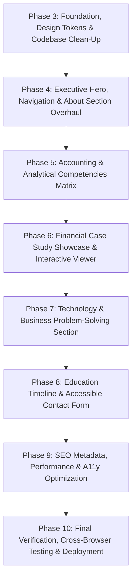

# Phased Implementation Roadmap
## Siam's Accounting-Focused Hybrid Professional Portfolio

**Document Version:** 1.0.0  
**Phase:** Phase 2: Implementation Planning & Execution Strategy  
**Date:** October 10, 2026  
**Implementation Stack:** React 19, Vite 8, Tailwind CSS 3.4, Framer Motion 12  
**Target Identity:** Md Ibna Siam — Accounting & Finance Professional in Development  

---

## 1. Roadmap Architecture & Execution Philosophy

This roadmap details the sequential, step-by-step implementation plan to transform the existing codebase into the target accounting portfolio defined in `PRD.md` and `DESIGN_SYSTEM.md`.

### Execution Principles:
1. **Incremental & Non-Destructive:** Each phase produces an independently buildable and functional state. No breaking intermediate stages.
2. **Regression Verification at Every Step:** Working features (dark/light theme toggle, Formspree contact submission, resume download link, active nav scrolling) must be validated after every phase.
3. **No Unnecessary Dependencies:** All enhancements will be implemented using the existing installed packages (`react`, `react-dom`, `vite`, `tailwindcss`, `framer-motion`, `react-icons`, `@vercel/speed-insights`).

---

## 2. Phase-by-Phase Execution Plan

---

### Phase 3: Design Foundation, Tokens & Codebase Clean-Up
- **Objective:** Establish the "Executive Financial Precision" design tokens in Tailwind, eliminate dead code and stray files, remove the artificial 1.6s render delay, and synchronize deployment configuration.
- **Scope:**
  - Delete unimported dead stylesheet: [src/App.css](file:///d:/Project/portfolio%20siam/src/App.css).
  - Remove empty stray folder: `src/{components,hooks,data,assets}`.
  - Delete unused template icons: [src/assets/react.svg](file:///d:/Project/portfolio%20siam/src/assets/react.svg), [src/assets/vite.svg](file:///d:/Project/portfolio%20siam/src/assets/vite.svg).
  - Update [tailwind.config.js](file:///d:/Project/portfolio%20siam/tailwind.config.js) with semantic tokens: deep navy slate, refined emerald primary, and amber variance colors.
  - Update [src/index.css](file:///d:/Project/portfolio%20siam/src/index.css) to import Google Fonts with `display=swap` and declare tabular number utility (`.tabular-nums`).
  - Modify [src/App.jsx](file:///d:/Project/portfolio%20siam/src/App.jsx): Remove artificial 1.6s `setTimeout` timer; mount `<main>` immediately with smooth entry opacity transition.
  - Reconcile [vite.config.js](file:///d:/Project/portfolio%20siam/vite.config.js) base path based on owner hosting decision.
- **Relevant Files:**
  - `src/App.css` (Delete)
  - `src/assets/react.svg`, `src/assets/vite.svg` (Delete)
  - `tailwind.config.js` (Modify)
  - `src/index.css` (Modify)
  - `src/App.jsx` (Modify)
  - `vite.config.js` (Modify)
- **Dependencies:** None.
- **Expected Outcome:** Clean project root, instantly rendering DOM (< 500ms FCP), active semantic color palette.
- **Acceptance Criteria:**
  - `npm run build` succeeds with zero errors.
  - Page renders immediately on refresh with no 1.6-second delay.
  - Dark and light mode toggle still functions properly via `useTheme`.
- **Testing Requirements:**
  - Run `npm run lint` and `npm run build`.
  - Verify that theme toggle works in browser.
- **Risks & Rollback:**
  - *Risk:* Removing `App.css` or template icons causes missing import errors.
  - *Mitigation:* Audited in Phase 1 — zero imports exist in any file. Rollback via git checkout if unexpected issues occur.

---

### Phase 4: Executive Hero, Navigation & About Section Overhaul
- **Objective:** Overhaul the top-of-funnel experience to establish Siam's professional accounting identity.
- **Scope:**
  - Overhaul [src/components/Navbar.jsx](file:///d:/Project/portfolio%20siam/src/components/Navbar.jsx): Update brand logo to "Md Ibna Siam", revise nav links (`About`, `Competencies`, `Case Studies`, `Tech & Business`, `Education`, `Contact`), add `aria-expanded` and keyboard `Escape` handler to mobile drawer.
  - Overhaul [src/components/Hero.jsx](file:///d:/Project/portfolio%20siam/src/components/Hero.jsx):
    - Replace coder terminal prompt (`> [text] |`) with executive typography.
    - Headline: *"Accounting & Finance Professional in Development"*.
    - Subtitle highlighting financial reporting, budgeting, taxation, and auditing.
    - CTAs: Primary *"Download Academic CV"* (Google Drive link with PDF icon) and Secondary *"Explore Case Studies"*.
    - Filter social links to remove broken placeholder (`twitter.com`).
  - Introduce Credential & Domain Ribbon below Hero (`DSE Ratio Analysis`, `NBR Tax Act 2023`, `Master Budgeting`, `Cost Accounting`, `Internal Audit`).
  - Overhaul [src/components/About.jsx](file:///d:/Project/portfolio%20siam/src/components/About.jsx):
    - Import canonical `SectionHeading` from standalone file; remove duplicate definition in `About.jsx`.
    - Present narrative on analytical rigor, accounting ethics, and career vision (ACCA career trajectory).
    - Display 4 factual academic profile highlights (BBA Accounting Candidate, Core Disciplines, Portfolio Depth [5 Case Studies + 3 Macro Papers], and ACCA Target).
- **Relevant Files:**
  - `src/components/Navbar.jsx`
  - `src/components/Hero.jsx`
  - `src/components/About.jsx`
  - `src/components/SectionHeading.jsx`
  - `src/data/portfolioData.js`
- **Dependencies:** Phase 3 color and font tokens.
- **Expected Outcome:** High-trust, professional first fold completely free of software engineer cliches.
- **Acceptance Criteria:**
  - Navigation smooth-scrolls to all active sections.
  - Mobile menu closes when a link is clicked or when `Escape` is pressed.
  - Resume button opens verified Google Drive CV in a new tab with `rel="noopener noreferrer"`.
  - Zero broken social links in Hero.
- **Testing Requirements:**
  - Mobile responsive test at 375px viewport.
  - Active section indicator test during page scroll.

---

### Phase 5: Accounting & Analytical Competencies Matrix
- **Objective:** Replace subjective percentage progress bars with structured, credential-backed competency grids.
- **Scope:**
  - Overhaul [src/components/Skills.jsx](file:///d:/Project/portfolio%20siam/src/components/Skills.jsx):
    - Eliminate numerical percentage bars (`88%`, `70%`).
    - Organize competencies into four structured domains:
      1. *Financial & Managerial Accounting*
      2. *Taxation & Regulatory Compliance (NBR / ITA 2023)*
      3. *Auditing & Internal Controls*
      4. *Financial & Office Software (Excel, Tally ERP, QuickBooks)*
    - Migrate hardcoded framework badges (`IFRS`, `BAS`, `Income Tax Act 2023`, `CVP Analysis`) from component JSX into [src/data/portfolioData.js](file:///d:/Project/portfolio%20siam/src/data/portfolioData.js).
    - Category filter tabs: *All*, *Accounting*, *Tax & Audit*, *Software*, *Soft Skills*.
- **Relevant Files:**
  - `src/components/Skills.jsx`
  - `src/data/portfolioData.js`
- **Dependencies:** Phase 3 tokens.
- **Expected Outcome:** Credible, professionally defensible skills matrix that passes recruiter scrutiny.
- **Acceptance Criteria:**
  - No percentage bars appear in the rendered UI.
  - Category filters smoothly filter competency cards using Framer Motion layout transitions.
  - Every card clearly articulates specific accounting topics or software tools.
- **Testing Requirements:**
  - Test all category filter tab clicks.
  - Verify layout transition stability on mobile screens.

---

### Phase 6: Financial Case Study Showcase & Interactive Viewer
- **Objective:** Refactor the monolithic 736-line `Projects.jsx` into a clean, modular showcase with direct, accessible case study drawers.
- **Scope:**
  - Deconstruct [src/components/Projects.jsx](file:///d:/Project/portfolio%20siam/src/components/Projects.jsx):
    - Create `src/components/projects/ProjectCard.jsx` (Card preview with image, category, key metric highlight, and action button).
    - Create `src/components/projects/CaseStudyModal.jsx` (Direct comprehensive case study viewer featuring Executive Summary, Problem Statement, Methodology, Financial Data Tables, and Strategic Recommendations).
    - Create `src/components/projects/FinancialTable.jsx` (Accessible tabular numbers view with horizontal scroll indicator for mobile).
  - Add URL hash deep linking (e.g. clicking a project sets hash `#case-study-square-pharma` allowing direct sharing).
  - Maintain all verified financial calculations, ratios, and findings for all 8 existing projects in `portfolioData.js`.
- **Relevant Files:**
  - `src/components/Projects.jsx`
  - `src/components/projects/ProjectCard.jsx` (New)
  - `src/components/projects/CaseStudyModal.jsx` (New)
  - `src/components/projects/FinancialTable.jsx` (New)
  - `src/data/portfolioData.js`
- **Dependencies:** Phase 3 & 4.
- **Expected Outcome:** High-impact case study presentation without nested modal confusion; modular codebase with < 200 lines per file.
- **Acceptance Criteria:**
  - Clicking any project opens the full case study viewer directly.
  - Financial data tables render with clean tabular figures (`font-mono text-xs tabular-nums`).
  - Mobile scrolling inside the modal is smooth and does not trigger double-scroll on the body.
  - Modal closes on `Escape` key or backdrop click.
- **Testing Requirements:**
  - Open and test every single one of the 8 projects.
  - Test tabular numbers alignment in financial statements on desktop and mobile.

---

### Phase 7: Business & Technology Problem-Solving Section
- **Objective:** Introduce a dedicated supporting section demonstrating how Siam applies technology and software to solve business and operational problems.
- **Scope:**
  - Create new component: `src/components/TechSolutions.jsx`.
  - Mount `<TechSolutions />` in [src/App.jsx](file:///d:/Project/portfolio%20siam/src/App.jsx) between Case Studies and Education.
  - Add navigation item `Tech & Business` (`#tech-solutions`) in Navbar.
  - Feature 2–3 curated projects (e.g. Financial/E-Commerce Data Management, Spreadsheet Automation) detailing:
    - *Business Friction & Context*
    - *Implemented System Architecture*
    - *Financial / Commercial Outcome*
    - *Tech Stack & Verified Repository Links*
- **Relevant Files:**
  - `src/components/TechSolutions.jsx` (New)
  - `src/App.jsx`
  - `src/components/Navbar.jsx`
  - `src/data/portfolioData.js`
- **Dependencies:** Phase 6.
- **Expected Outcome:** Seamless demonstration of hybrid capability that reinforces—rather than overshadows—the core accounting identity.
- **Acceptance Criteria:**
  - Clear visual distinction showing this is a supporting capability (2-column layout, compact cards).
  - Valid links to source code repositories where applicable.
- **Testing Requirements:**
  - Anchor link navigation `#tech-solutions` scrolls to correct section.

---

### Phase 8: Education Timeline & Accessible Contact Form Overhaul
- **Objective:** Polish the education section and transform the contact form into an accessible, error-resilient communication channel.
- **Scope:**
  - Overhaul [src/components/Experience.jsx](file:///d:/Project/portfolio%20siam/src/components/Experience.jsx):
    - Rename section title accurately to *"Education & Qualifications"*.
    - Present clean vertical timeline with DIU BBA Accounting, HSC at Ghatail Cantonment College, and SSC.
    - Highlight core coursework badges (Financial Accounting, Auditing, Taxation, Corporate Finance).
  - Overhaul [src/components/Contact.jsx](file:///d:/Project/portfolio%20siam/src/components/Contact.jsx):
    - Shift messaging from freelance gigs to internships, trainee accountant roles, and academic collaboration.
    - Wrap Formspree `fetch` in `try...catch` with inline error state for network failures.
    - Add explicit `id` attributes to inputs and `htmlFor` to `<label>` elements.
    - Add hidden honeypot field (`_gotcha`) for spam prevention.
    - Add inquiry type selector (Internship / Entry-Level Role / Academic / General).
  - Polish [src/components/Footer.jsx](file:///d:/Project/portfolio%20siam/src/components/Footer.jsx):
    - Update branding, current dynamic year, verified social links, and smooth back-to-top button.
- **Relevant Files:**
  - `src/components/Experience.jsx`
  - `src/components/Contact.jsx`
  - `src/components/Footer.jsx`
  - `src/data/portfolioData.js`
- **Dependencies:** Phase 7.
- **Expected Outcome:** Full WCAG 2.1 AA accessibility compliance on all form fields; reliable contact channel.
- **Acceptance Criteria:**
  - Form inputs are correctly associated with labels for screen readers.
  - Network disconnect triggers visible inline error banner rather than silent failure.
  - Successful submission displays polite confirmation message with reset option.
- **Testing Requirements:**
  - Test client-side validation for empty fields and invalid emails.
  - Verify that clicking labels focuses corresponding inputs.

---

### Phase 9: SEO Metadata, Performance & A11y Optimization
- **Objective:** Maximize search discoverability, optimize bundle size, and achieve high Core Web Vitals.
- **Scope:**
  - Update [index.html](file:///d:/Project/portfolio%20siam/index.html):
    - Title: `Md Ibna Siam | Accounting & Finance Portfolio`
    - Meta description highlighting BBA in Accounting at Daffodil International University.
    - Complete Open Graph tags (`og:title`, `og:description`, `og:image`, `og:url`, `og:type`).
    - Twitter card metadata.
    - Correct favicon MIME type and link.
  - Optimize Assets:
    - Replace oversized 378 KB `favicon.png` with optimized multi-size assets (< 15 KB).
    - Convert `siam.jpeg` (203 KB) to WebP format.
  - Bundle Optimization in [vite.config.js](file:///d:/Project/portfolio%20siam/vite.config.js):
    - Configure Rollup `manualChunks` to split `react`, `framer-motion`, and `react-icons`.
    - Lazy-load case study viewer modal via `React.lazy()` and `Suspense`.
  - Rewrite [README.md](file:///d:/Project/portfolio%20siam/README.md): Replace template "Alex Morgan" text with comprehensive portfolio documentation.
- **Relevant Files:**
  - `index.html`
  - `public/favicon.png`
  - `src/assets/siam.jpeg`
  - `vite.config.js`
  - `README.md`
- **Dependencies:** Phases 3–8.
- **Expected Outcome:** Primary JavaScript bundle < 160 kB gzip; professional social preview cards on LinkedIn and WhatsApp.
- **Acceptance Criteria:**
  - `npm run build` generates split chunks (`vendor`, `framer`, `icons`) with no chunk > 200 kB.
  - `index.html` passes HTML validation with zero meta syntax errors.
  - Social sharing debuggers render accurate rich preview cards.
- **Testing Requirements:**
  - Inspect `dist/` bundle sizes after build.
  - Validate Open Graph tags via metadata linter.

---

### Phase 10: Final Verification, Cross-Browser Testing & Deployment
- **Objective:** Final end-to-end regression testing and deployment handoff.
- **Scope:**
  - Complete end-to-end audit:
    - Theme toggle persistence across page reloads.
    - All 8 case study modals open, render tables, and close cleanly.
    - Contact form validation and submission flow.
    - Responsive layout verification from 320px to 2560px screen widths.
    - Keyboard navigation (Tab, Enter, Escape).
  - Verify production build with `npm run build` and `npm run preview`.
  - Prepare deployment instructions for chosen host (Vercel or GitHub Pages).
- **Relevant Files:** Whole repository.
- **Dependencies:** All previous phases.
- **Expected Outcome:** Production-ready portfolio ready for deployment to the live URL.
- **Acceptance Criteria:**
  - `npm run lint` passes with 0 errors.
  - `npm run build` compiles with 0 errors in < 10 seconds.
  - Zero console errors during full navigation walkthrough.

---

## 3. Regression Testing Protocol (Working Features Checklist)

The following existing working features must be regression-tested after every single implementation phase:

| Feature | Verification Method | Pass Criteria |
|---|---|---|
| **Theme Toggle** | Click Sun/Moon icon in header | Page toggles between dark/light; preference persists in `localStorage` |
| **CV Download** | Click "Download Academic CV" button | Opens verified Google Drive PDF link in new tab |
| **Section Scrolling** | Click all nav links in Navbar & Mobile Menu | Smoothly scrolls to `#about`, `#skills`, `#projects`, `#education`, `#contact` |
| **Mobile Drawer** | Open on screen width < 768px | Opens drawer smoothly; closes upon link selection or backdrop tap |
| **Case Study View** | Click project cards | Case study viewer opens without throwing React unhandled exceptions |
| **ESLint Check** | Run `npm run lint` | Exits with code 0 (0 errors, 0 warnings) |
| **Vite Production Build** | Run `npm run build` | Compiles successfully without bundle warnings |
