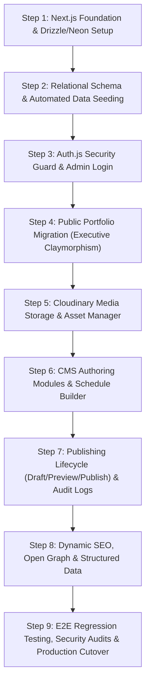

# Next.js Full Portfolio CMS Migration Plan
**Document Version:** 1.0.0  
**Phase:** Phase 1: Architecture Audit & Next.js Migration Feasibility  
**Date:** October 21, 2026  
**Status:** Approved for Implementation Execution  
**Target Architecture:** Next.js (App Router), Neon PostgreSQL, Drizzle ORM, Auth.js, Cloudinary  
**Design Direction:** Executive Claymorphism  
**Production Site:** [https://ibnasiam.vercel.app/](https://ibnasiam.vercel.app/)  
**Repository:** [https://github.com/ibna-siam/Portfolio](https://github.com/ibna-siam/Portfolio)  

---

## 1. Migration Strategy: Dual-Track Parallel Transition

### 1.1 Strategy Evaluation: In-Place Rewrite vs. Incremental Migration
Two potential migration approaches were evaluated:
1. **Gradual In-Place Hybrid (Micro-frontend / Proxying):** Running Vite and Next.js in parallel via reverse proxy or subpath routing.  
   *Assessment:* Unnecessary complexity for a single-page portfolio with ~1,500 lines of UI code. Introduces cross-origin session issues for the `/admin` panel and adds latency.
2. **Dual-Track Parallel Transition (Recommended):**  
   - The current production site (`https://ibnasiam.vercel.app/`) remains untouched on `main`.
   - All Next.js and Full Portfolio CMS development takes place on a dedicated feature branch (`feat/nextjs-cms-migration`).
   - Every phase produces an independently testable Vercel Preview Deployment.
   - The production cutover occurs only after the staging deployment passes 100% of the validation and regression gates.

---

## 2. Page & Component Migration Inventory

### 2.1 UI Component Migration Assessment

| Current Component | Lines | Current Role | Target Next.js Architecture | Migration Treatment |
|---|---|---|---|---|
| `App.jsx` | 35 | Root layout & theme wrapper | `app/(public)/layout.tsx` & `app/(public)/page.tsx` | **Rewrite** into Next.js App Router root layout with SSR-safe `ThemeProvider`. |
| `Navbar.jsx` | 176 | Header, theme toggle, mobile drawer | `components/public/Navbar.tsx` (`"use client"`) | **Adapt:** Convert to TypeScript, add subtle Claymorphic bevels, retain Escape key listener. |
| `Hero.jsx` | 231 | Headline, portrait, CV CTA, ribbon | `components/public/Hero.tsx` | **Adapt:** Convert portrait to `next/image` with Cloudinary loader, server-render domain ribbon. |
| `About.jsx` | 141 | Narrative, 4 factual highlight cards | `components/public/About.tsx` | **Adapt:** Server-render factual highlight cards; add Claymorphic card depth tokens. |
| `Skills.jsx` | 159 | Competency matrix, discipline tabs | `components/public/Skills.tsx` (`"use client"`) | **Adapt:** Fetch 16 competencies dynamically from Neon PostgreSQL via Drizzle ORM. |
| `Projects.jsx` | 949 | Monolithic showcase & 5-tab modal | `components/public/projects/` (Deconstructed) | **Deconstruct & Refactor:** Split into `ProjectCard.tsx`, `CaseStudyModal.tsx`, `FinancialTable.tsx`. Also generate dynamic pages at `/case-studies/[slug]`. |
| `TechSolutions.jsx`| 197 | 3 business/tech solutions | `components/public/TechSolutions.tsx` | **Adapt:** Fetch supporting solutions from `tech_solutions` table in Neon PostgreSQL. |
| `Experience.jsx` | 247 | Timeline & ACCA roadmap card | `components/public/Experience.tsx` | **Adapt:** Fetch education milestones and ACCA trajectory from Neon PostgreSQL. |
| `Contact.jsx` | 489 | Formspree form, email copy button | `components/public/Contact.tsx` (`"use client"`) | **Adapt:** Preserve Formspree endpoint (`mjgzqeeg`); add optional Server Action relay. |
| `Footer.jsx` | 158 | Colophon, navigation, back-to-top | `components/public/Footer.tsx` | **Adapt:** Preserve canonical links and smooth scroll-to-top with `prefers-reduced-motion`. |
| `SectionHeading.jsx`| 17 | Reusable section header | `components/ui/SectionHeading.tsx` | **Adapt:** Add Claymorphic eyebrow pill styling. |
| `Loader.jsx` | 39 | Spinner / splash screen | `app/loading.tsx` | **Adapt:** Convert to Next.js streaming loading boundary. |

---

## 3. Database Schema & Content Migration Sequence

### 3.1 Relational Schema Definitions (Drizzle ORM)
The database schema will be organized into 9 relational tables:

```
┌────────────────────────────────────────────────────────┐
│                   NEON POSTGRESQL TABLES               │
├────────────────────────────────────────────────────────┤
│ 1. users                  - Admin credentials & roles  │
│ 2. case_studies           - 8 academic research papers │
│ 3. financial_schedules    - Tabular financial schedules│
│ 4. case_study_discrepancies - 4 integrity disclosures  │
│ 5. competencies           - 16 core competencies       │
│ 6. academic_milestones    - 3 education milestones     │
│ 7. tech_solutions         - 3 business/tech projects   │
│ 8. media_assets           - Cloudinary uploaded assets │
│ 9. activity_logs          - Append-only audit trail    │
└────────────────────────────────────────────────────────┘
```

### 3.2 Automated Seeding Pipeline (`scripts/seed.ts`)
To prevent data loss or manual transcription errors, an automated script will read existing static JavaScript files and seed Neon PostgreSQL:
1. **Seed Users:** Create initial administrative user record with hashed password (via `bcryptjs`).
2. **Seed Case Studies:** Read 8 projects from `src/data/portfolioData.js`. Insert narrative text, executive summaries, problem statements, methodologies, findings, and recommendations.
3. **Seed Financial Schedules:** Read `dataTables` from `fullReport` of each project. Insert into `financial_schedules` with `jsonb` headers and rows, preserving numerical precision.
4. **Seed Discrepancy Registry:** Read `src/data/caseStudyIntegrity.js`. Insert 3 mathematical discrepancy disclosures (Individual Tax return refund conflict, StyleTex RMG contribution margin conflict, FIFA World Cup economic impact conflict) into `case_study_discrepancies`.
5. **Seed Competencies:** Read 16 items from `src/data/competenciesData.js` and insert with framework tags and domain keys.
6. **Seed Education & Journey:** Read 3 confirmed milestones and ACCA trajectory card from `src/data/academicJourneyData.js`.
7. **Seed Tech Solutions:** Read 3 business/tech projects from `src/data/techSolutionsData.js`.

---

## 4. Authentication & Media Integration Sequence

### 4.1 Authentication Implementation Sequence (Auth.js v5)
1. Install `next-auth@beta`, `@auth/drizzle-adapter`, `bcryptjs`.
2. Configure `auth.ts` with Credentials Provider and Drizzle adapter.
3. Configure `middleware.ts` to guard `/admin/:path*` (excluding `/admin/login`).
4. Build accessible Claymorphic login page at `app/(admin)/admin/login/page.tsx`.
5. Verify that unauthenticated requests redirect to login with 307 redirect status.

### 4.2 Cloudinary Media Integration Sequence (Phase 4 Completed)
1. Installed `cloudinary@2.11.0` exclusively for server-side operations (`src/lib/cloudinary.ts`).
2. Configured server-side Cloudinary client using environment variables: `CLOUDINARY_CLOUD_NAME`, `CLOUDINARY_API_KEY`, `CLOUDINARY_API_SECRET` (with secret strictly hidden from client and logs).
3. Created authenticated Server Action `getUploadSignatureAction` (`src/app/(admin)/admin/media/actions.ts`) to authorize direct browser uploads without routing large binary streams through Next.js serverless functions.
4. Created authenticated Server Action `registerMediaAssetAction` with cryptographic signature verification (`verifyCloudinaryResponseSignature`) and format whitelisting (`jpg`, `jpeg`, `png`, `webp` <= 5 MB).
5. Created authenticated Server Action `deleteMediaAssetAction` with published-content reference protection (checking `siteSettings` avatar/resume references).
6. Uploaded `src/assets/siam.jpeg` via `scripts/upload-portrait.ts` and recorded its verified metadata in `media_assets` (`portfolio/media/siam_portrait`).
7. Built Executive Claymorphism Media Library at `/admin/media` (`src/app/(admin)/admin/media/page.tsx` & `media-client.tsx`).
8. Configured Next.js `next.config.ts` to allow image loading from `res.cloudinary.com`.
9. Added 24-point automated test suite (`scripts/test-media-pipeline.ts` / `npm run test:media`) passing 100%.

---

## 5. Implementation Roadmap & Execution Sequence



### Milestone Checkpoints & Deliverables:
- **Milestone 1 (Database & Models Verified):** Neon PostgreSQL connected; Drizzle schema generated and migrated; 100% of historical data seeded and verified via query.
- **Milestone 2 (Admin Boundary Secured):** Auth.js middleware active; unauthenticated users blocked from `/admin`; admin login functional.
- **Milestone 3 (Public Interface Replatformed):** Public portfolio rendered with React Server Components; all 8 case studies open in interactive modal; Executive Claymorphism styling active; dark/light theme functional.
- **Milestone 4 (CMS Authoring Operational):** Admin can create/edit case studies, build tabular schedules, upload media via Cloudinary, and toggle draft/preview/published states.
- **Milestone 5 (Production Release):** E2E test suite green; Lighthouse scores > 90; production cutover executed on Vercel.

---

## 6. Comprehensive Validation & Quality Gates

Each implementation phase must satisfy strict automated gates before proceeding:

| Validation Gate | Verification Command / Procedure | Pass Criteria |
|---|---|---|
| **TypeScript Typecheck** | `npm run type-check` (`tsc --noEmit`) | 0 type errors, strict null checks enabled |
| **ESLint Verification** | `npm run lint` | 0 errors, 0 warnings across all `.ts`, `.tsx`, `.js` |
| **Database Verification** | `npm run db:verify` | 100% match of 8 case studies, 16 competencies, 3 solutions |
| **Production Build** | `npm run build` | Compiles in < 15s with zero build warnings |
| **Accessibility Audit** | Automated axe-core / Lighthouse | 0 critical violations, WCAG 2.1 AA compliant |
| **Lighthouse Performance** | Chrome Lighthouse Audit | Performance > 90, Accessibility > 95, SEO = 100 |

---

## 7. Rollback & Contingency Strategy

1. **Instant Vercel Instant Rollback:**
   - Because the live site is hosted on Vercel, any release regression can be resolved instantaneously (in < 10 seconds) by clicking **"Rollback to Previous Deployment"** in the Vercel Dashboard.
2. **Database Backup & Branching:**
   - Neon Serverless PostgreSQL supports point-in-time recovery and instant database branching. Before executing the production data seed, a parent branch snapshot will be established.
3. **Git Branch Isolation:**
   - The production `main` branch will remain untouched until the feature branch `feat/nextjs-cms-migration` is fully audited and approved by the project owner.

---

## 8. Explicit Go / No-Go Decision Criteria

- [x] Phase 0 Documentation Audit and Alignment complete.
- [x] Phase 1 Technical Architecture Audit complete (`ARCHITECTURE_AUDIT.md`).
- [x] Next.js Migration Feasibility Plan established (`MIGRATION_PLAN.md`).
- [x] Implementation Phase 1 (Next.js Foundation & Neon/Drizzle Setup) completed and validated on `feat/nextjs-cms-migration`.
- [x] Neon Serverless PostgreSQL database provisioned by project owner and connectivity verified.
- [x] Implementation Phase 2 (Relational Schema & Historical Content Seeding) completed and verified in Neon database.
- [x] Implementation Phase 3 (Auth.js Integration & Protected Admin Boundary) completed and validated.
- [x] Implementation Phase 4 (Cloudinary Media Storage & Asset Management) completed and validated.
- [x] Implementation Phase 5 (Core CMS Content Models & Admin UI) completed and validated.
- [x] Implementation Phase 6 (Public Portfolio Migration & Executive Claymorphism) completed and validated on `feat/nextjs-cms-migration`.
- [ ] Explicit project owner authorization granted to begin Implementation Phase 7 (Testing, Performance, Accessibility & Final Cutover Verification).

---

## 9. Architectural Deviations & Implementation Constraints (Phases 1 through 6)

During Implementation Phases 1 through 6, the following safe architectural refinements were implemented on `feat/nextjs-cms-migration`:
1. **Non-Destructive Coexistence Strategy:**  
   Instead of deleting `vite.config.js` or overwriting `index.html`, the root repository configuration was updated to support both Next.js App Router and legacy Vite concurrently (`dev`, `build`, `start` for Next.js; `dev:vite`, `build:vite`, `preview:vite` for Vite). The legacy Vite application was validated via `npm run build:vite` (compiled in 2.81s), guaranteeing zero loss of recoverability.
2. **Lazy Database Client Initialization:**  
   In `src/lib/db/index.ts`, the database connection is wrapped in a lazy getter (`getDb()`). This architectural refinement prevents `next build` from failing during static generation when `DATABASE_URL` is unprovisioned, while still enforcing server-only execution and preventing client credential leakage.
3. **TypeScript / ESLint Unified Parsing:**  
   To allow ESLint to lint both existing legacy JavaScript JSX files and new TypeScript TS/TSX files without parser conflicts, `typescript-eslint` was integrated into the ESLint flat config alongside browser and Node globals. All 0 errors / 0 warnings were verified.
4. **Idempotent Data Seeding Pipeline:**  
   `scripts/seed.ts` implements conflict-aware upsert logic matching on deterministic slugs and source IDs. First execution cleanly created 43 records; second execution updated 43 records with 0 duplicates and 0 errors.
5. **Faithful Discrepancy Registry:**  
   All 3 financial arithmetic/definitional discrepancies (VAL-09, VAL-10, VAL-11) and the Square Pharma overhead proposal clarification (VAL-08) were ported verbatim to `case_study_discrepancies` and `audit_notes` JSONB fields without synthetic reconciliation.
6. **Strict Privacy Isolation:**  
   Personal phone number is persisted with `phonePrivacyStatus = 'hidden'`, safeguarding recruiter and owner privacy guardrail VAL-07.
7. **Credentials-Based JWT Auth Strategy (Zero Adapter DDL Changes):**  
   Auth.js v5 (`next-auth@5.0.0-beta.32`) was implemented using the Credentials Provider paired with a JWT session strategy. In Auth.js, credentials authentication operates exclusively with JWT tokens. Because database session adapters are architecturally unnecessary for credentials flows, no superfluous adapter tables (`sessions`, `accounts`, `verification_tokens`) were introduced. The existing, verified `users` table was reused directly without any breaking DDL migrations.
8. **Layered Authorization & Rate Limiting Defense:**  
   Administrative access is guarded by three distinct security layers:
   - Next.js Edge Middleware (`src/middleware.ts`): Intercepts `/admin/:path*` routes and redirects unauthenticated or non-admin visitors to `/admin/login`.
   - Reusable Server Authorization Guard (`requireAdmin()` in `src/lib/auth.ts`): Re-verifies active session and admin role in Server Components and Server Actions.
   - Brute-Force Rate Limiting (`src/lib/auth-limiter.ts`): Locks out any identifier exceeding 5 failed login attempts within a 15-minute sliding window.
   - Open-Redirect Protection (`sanitizeCallbackUrl()`): Strictly confines return URL redirection to valid internal `/admin` paths.
9. **Safe Idempotent Admin Provisioning:**  
   `scripts/create-admin.ts` provides a secure CLI tool (`npm run db:admin:create`) to provision or rotate administrative accounts using bcrypt cost factor 12. Accidental credential overwrites are prevented; credential rotation requires explicit `--update` confirmation. Real credentials are never logged or exposed.
10. **Signed Direct Media Upload Architecture (Phase 4):**  
    Client browser uploads directly to Cloudinary using short-lived HMAC-SHA tickets generated server-side. Upload responses are verified against Cloudinary's cryptographic signature before saving metadata to `media_assets`. Reference checks against `siteSettings` prevent deleting media in active published use.
11. **Tabular Financial Schedule Matrix & Discrepancy Protection (Phase 5):**  
    Case Studies editor features an interactive matrix editor for financial tables enforcing `.tabular-nums` formatting. Discrepancy disclosures (VAL-09, VAL-10, VAL-11) are protected by persistent editor warnings and a server-side deletion safeguard that strictly prohibits deleting case studies with attached disclosures.
12. **Append-Only Revisions & Activity Auditing (Phase 5):**  
    All mutations generate sequential, append-only JSONB snapshots in `content_revisions` and user-attributed event entries in `activity_logs`.
13. **Server-Isolated Data Access Layer for Public Surfaces (Phase 6):**  
    `src/lib/public-data.ts` serves as the single source of truth for public queries, strictly enforcing `status = 'published'`, completely scrubbing private contact details (VAL-07), and linking financial schedules and disclosures through explicit relational queries.
14. **Cryptographic Draft Mode & Open-Redirect Neutralization (Phase 6):**  
    Next.js Draft Mode endpoints (`/api/draft/enable`, `/api/draft/disable`) require an authenticated Auth.js administrator session (`role === 'admin'`) and validate target URLs against `^\/[a-zA-Z0-9_\-\/]*$`, preventing open-redirect exploits and unauthorized draft data leaks.
15. **Executive Claymorphism Public Components (Phase 6):**  
    Public UI components reside cleanly in `src/components/public/`, maintaining strict separation from legacy Vite components, featuring `.tabular-nums` financial schedules, accessible theme switching, responsive design, and prominent discrepancy disclosure notices.

