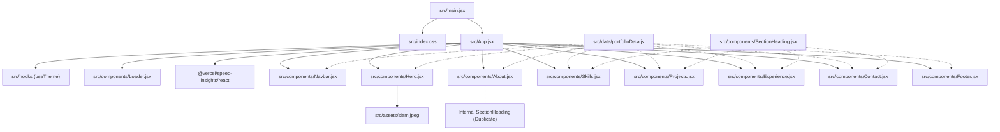

# Portfolio File Inventory: Siam's Personal Portfolio
**Audit Reference:** Phase 1 Audit  
**Date:** October 9, 2026  
**Auditor:** Senior Frontend Engineer & UI/UX Auditor  
**Repository:** [ibna-siam/Portfolio](https://github.com/ibna-siam/Portfolio)

---

## 1. Core Application Files & Responsibilities

| File Path | Lines | Size | Current Responsibility | Future Modification Status |
|---|---|---|---|---|
| [`index.html`](file:///d:/Project/portfolio%20siam/index.html) | 14 | 361 B | Root HTML template; defines title, favicon link, and script entry point | **Requires High Modification**: Needs proper title, meta description, Open Graph tags, canonical link, and correct favicon MIME type. |
| [`src/main.jsx`](file:///d:/Project/portfolio%20siam/src/main.jsx) | 11 | 233 B | React application bootstrap; mounts `<App />` into `#root` inside `<StrictMode>` | **Remain Unchanged**: Clean, canonical entry point. |
| [`src/App.jsx`](file:///d:/Project/portfolio%20siam/src/App.jsx) | 44 | 1.3 KB | Top-level layout container; controls dark theme class, artificial splash timer, and renders sections | **Requires High Modification**: Remove artificial 1.6s timeout, streamline loader behavior, and optimize Vercel SpeedInsights integration. |
| [`src/index.css`](file:///d:/Project/portfolio%20siam/src/index.css) | 35 | 1.0 KB | Global styling; imports Google Fonts (Playfair Display, DM Sans, JetBrains Mono), Tailwind base directives, and noise utility | **Requires Moderate Modification**: Refine typography imports, ensure font display swap, adjust base styling tokens. |
| [`src/App.css`](file:///d:/Project/portfolio%20siam/src/App.css) | 185 | 2.9 KB | Unused legacy Vite counter and logo CSS | **To Be Deleted**: Complete dead boilerplate code; not imported anywhere. |
| [`src/hooks/index.js`](file:///d:/Project/portfolio%20siam/src/hooks/index.js) | 88 | 2.6 KB | Custom React hooks (`useTypingEffect`, `useTheme`, `useActiveSection`) | **Requires Minor Modification**: Optimize `useActiveSection` dependency array to prevent unnecessary observer resets; streamline `useTheme`. |
| [`src/data/portfolioData.js`](file:///d:/Project/portfolio%20siam/src/data/portfolioData.js) | 590 | 44.7 KB | Central content store containing `personal`, `about`, `skills`, `projects`, and `experience` | **Requires High Modification**: Update personal taglines, add technology/business hybrid projects, remove arbitrary skill percentage numbers, add certification array, replace placeholder links. |

---

## 2. Component Inventory

| Component File | Lines | Size | Current Responsibility | Dependencies | Future Modification Status |
|---|---|---|---|---|---|
| [`src/components/Navbar.jsx`](file:///d:/Project/portfolio%20siam/src/components/Navbar.jsx) | 137 | 5.3 KB | Fixed top navigation, theme toggle (sun/moon), mobile menu drawer, active section highlighting | `framer-motion`, `react-icons/fi`, `useActiveSection`, `portfolioData.personal` | **Requires Moderate Modification**: Add keyboard accessibility (Escape to close mobile menu), refine brand styling and nav links. |
| [`src/components/Hero.jsx`](file:///d:/Project/portfolio%20siam/src/components/Hero.jsx) | 202 | 8.2 KB | Hero landing area, animated typing role banner, resume download button, social icons, avatar with floating badge | `framer-motion`, `react-icons/fi`, `portfolioData.personal`, `useTypingEffect`, `siamPhoto` | **Requires High Modification**: Refocus copy toward Accounting & Finance; replace terminal-style prompt (`>`) with executive badge; fix placeholder social link. |
| [`src/components/About.jsx`](file:///d:/Project/portfolio%20siam/src/components/About.jsx) | 115 | 5.1 KB | Professional introduction, education stats, summary paragraph, duplicate `SectionHeading` | `framer-motion`, `portfolioData.personal`, `portfolioData.about` | **Requires Moderate Modification**: Import `SectionHeading` from standalone file; expand academic achievements and professional vision. |
| [`src/components/Skills.jsx`](file:///d:/Project/portfolio%20siam/src/components/Skills.jsx) | 115 | 4.7 KB | Filterable category tabs, percentage skill bars, hardcoded certification badges | `framer-motion`, `portfolioData.skills`, `SectionHeading` | **Requires High Modification**: Replace percentage bars with professional competency matrices, move hardcoded badges into `portfolioData.js`. |
| [`src/components/Projects.jsx`](file:///d:/Project/portfolio%20siam/src/components/Projects.jsx) | 736 | 29.6 KB | 8-project grid, category filter tabs, two-tier modal viewer (`SummaryModal` and `ReportModal`) with multi-tab report tables | `framer-motion`, `react-icons/fi`, `portfolioData.projects`, `SectionHeading` | **Requires High Modification / Refactor**: Decompose 736-line monolith into smaller modular files (`ReportModal.jsx`, `SummaryModal.jsx`, `ProjectCard.jsx`); add support for software/business projects. |
| [`src/components/Experience.jsx`](file:///d:/Project/portfolio%20siam/src/components/Experience.jsx) | 97 | 4.2 KB | Vertical timeline displaying educational milestones (BBA at DIU, HSC, SSC) | `framer-motion`, `react-icons/fi`, `portfolioData.experience`, `SectionHeading` | **Requires Moderate Modification**: Rename section accurately to "Education & Qualifications" or add dual tabs to support future practical/extracurricular experience. |
| [`src/components/Contact.jsx`](file:///d:/Project/portfolio%20siam/src/components/Contact.jsx) | 246 | 9.7 KB | Direct contact channels (email, phone, address), Formspree submission form with client validation | `framer-motion`, `react-icons/fi`, `portfolioData.personal`, `SectionHeading` | **Requires Moderate Modification**: Wrap network fetch in `try...catch`, add input `id` and label `htmlFor` attributes, add honeypot spam protection. |
| [`src/components/Footer.jsx`](file:///d:/Project/portfolio%20siam/src/components/Footer.jsx) | 59 | 2.4 KB | Brand signature, dynamic year copyright, social links, back-to-top smooth scroll button | `framer-motion`, `react-icons/fi`, `portfolioData.personal` | **Requires Minor Polish**: Clean social links, ensure accessible aria-labels. |
| [`src/components/Loader.jsx`](file:///d:/Project/portfolio%20siam/src/components/Loader.jsx) | 39 | 1.4 KB | Animated splash overlay with bouncing dots | `framer-motion` | **Requires Review / Modification**: Either remove completely to maximize page speed or adapt into a non-blocking initial transition. |
| [`src/components/SectionHeading.jsx`](file:///d:/Project/portfolio%20siam/src/components/SectionHeading.jsx) | 17 | 583 B | Standardized section header displaying uppercase eyebrow label, serif title, and centered subtitle | None | **Preserve & Reuse**: Canonical section heading component to be imported by all sections. |

---

## 3. Configuration & Tooling Files

| Configuration File | Responsibility | Risk / Caution Level | Action Needed |
|---|---|---|---|
| [`vite.config.js`](file:///d:/Project/portfolio%20siam/vite.config.js) | Configures Vite React plugin and base asset path (`base: '/'`) | **High Risk** | Reconcile base path with deployment target (GitHub Pages vs Vercel). Add rollup `manualChunks` to split heavy libraries. |
| [`package.json`](file:///d:/Project/portfolio%20siam/package.json) | NPM scripts, dependencies (`react 19`, `framer-motion`, `@vercel/speed-insights`), devDependencies | **High Risk** | Remove conflicting `"homepage"` and `"deploy"` scripts if migrating fully to Vercel/custom domain, or align them. |
| [`package-lock.json`](file:///d:/Project/portfolio%20siam/package-lock.json) | Deterministic dependency tree lockfile | **Do Not Modify Manually** | Preserved. |
| [`tailwind.config.js`](file:///d:/Project/portfolio%20siam/tailwind.config.js) | Custom color palette (`ink`, `teal`, `accent`), fonts (`display`, `body`, `mono`), keyframe animations | **Medium Risk** | Extend color palette for premium corporate accounting aesthetics (deep navy, warm slate, subtle gold/bronze). |
| [`postcss.config.js`](file:///d:/Project/portfolio%20siam/postcss.config.js) | PostCSS pipeline connecting Tailwind CSS and Autoprefixer | **Preserve Unchanged** | Standard, working configuration. |
| [`eslint.config.js`](file:///d:/Project/portfolio%20siam/eslint.config.js) | ESLint flat config with React Hooks and React Refresh rules | **Preserve Unchanged** | Working properly; `npm run lint` passes with 0 errors. |
| [`.vercel/repo.json`](file:///d:/Project/portfolio%20siam/.vercel) | Vercel CLI linking configuration | **Preserve Unchanged** | Holds local deployment project link. |
| [`README.md`](file:///d:/Project/portfolio%20siam/README.md) | Project repository documentation | **High Priority Rewrite** | Replace obsolete "Alex Morgan" template text with accurate portfolio documentation. |

---

## 4. Assets & Public Files

| File Path | Type | File Size | Status | Recommendation |
|---|---|---|---|---|
| [`public/favicon.png`](file:///d:/Project/portfolio%20siam/public/favicon.png) | Static Image | 378.9 KB | **Severe Inefficiency** | Compress and generate standard multi-size favicon (.ico and .png under 15 KB). |
| [`src/assets/siam.jpeg`](file:///d:/Project/portfolio%20siam/src/assets/siam.jpeg) | Source Image | 203.1 KB | Active profile portrait | Convert to modern `.webp` and optimize dimensions. |
| [`src/assets/react.svg`](file:///d:/Project/portfolio%20siam/src/assets/react.svg) | SVG Vector | 4.1 KB | **Unused Template File** | Delete in Phase 2. |
| [`src/assets/vite.svg`](file:///d:/Project/portfolio%20siam/src/assets/vite.svg) | SVG Vector | 8.7 KB | **Unused Template File** | Delete in Phase 2. |
| `src/{components,hooks,data,assets}` | Directory | 0 B | **Stray Empty Directory** | Delete in Phase 2. |

---

## 5. Dependency Interconnection Map

---

## 6. Critical Areas Requiring Special Care During Redesign

1. **`portfolioData.js` Data Structure Integrity**: The current data file is 44.7 KB and holds complete financial tables, ratios, findings, and conclusions for 8 projects. When restructuring, all verified financial calculations and academic data must be strictly preserved.
2. **Tailwind Color Token Compatibility**: Multiple components reference custom Tailwind tokens (`ink-50` through `ink-950`, `teal-400` through `teal-700`, `accent-400` through `accent-600`). Any updates to `tailwind.config.js` must maintain backward compatibility or migrate class names systematically.
3. **Formspree Endpoint Continuity**: The contact form in `Contact.jsx` uses endpoint `mjgzqeeg`. This endpoint belongs to Siam's active Formspree account. It must not be accidentally deleted or overwritten with a dummy string.
