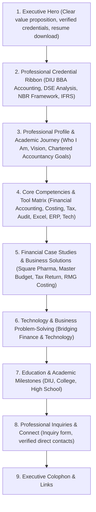

# Portfolio Redesign Recommendations & Strategic Roadmap
**Project:** Siam's Personal Portfolio Redesign  
**Document Type:** Phase 1 Architectural & UI/UX Strategic Proposal  
**Auditor & Strategist:** Senior Frontend Engineer & UI/UX Design Auditor  
**Date:** October 9, 2026  
**Status:** Audit Recommendations Only (Non-Destructive — Awaiting Owner Approval)

---

## 1. Executive Vision & Brand Positioning

### Core Positioning Statement
> **"Md Ibna Siam — Accounting & Finance Professional in Development, with Practical Business Management & Technology Problem-Solving Skills."**

The objective of the portfolio redesign is to position Siam as an elite, future-ready accounting and finance candidate. He is not merely an accounting student reading textbooks; he is an analytical thinker capable of executing financial statement analysis, ratio evaluations, cost sheets, master budgeting, and NBR tax computations, while leveraging modern software, automation, and technological tools to solve business challenges.

### Target Audiences & Hiring Personas
1. **Chartered Accountancy (CA) & Audit Firms** (Big 4 affiliates, ICAB registered firms in Bangladesh): Looking for rigorous analytical discipline, familiarity with IFRS/IAS and Bangladesh Standards on Auditing (BSA), attention to detail, and audit readiness.
2. **Corporate Finance & Accounting Departments** (MNCs, FMCG, Pharmaceuticals, RMG groups): Seeking candidates who can manage reconciliations, working capital, cost sheets, variance analysis, and master budgets.
3. **FinTech & Tech-Forward Business Operations**: Looking for business-literate candidates who can bridge the gap between finance/accounting workflows and software systems, data analysis, and automation.

---

## 2. Proposed Visual Direction & Aesthetic System

### Theme: "Executive Financial Precision"
Move away from generic developer templates (dark terminal monospace aesthetics with `>` symbols) toward a sophisticated, modern financial editorial identity.

- **Primary Aesthetic:** Refined corporate editorial with high-contrast typography, crisp borders, subtle glassmorphic accents, and clean data cards.
- **Color Palette Proposal:**
  - **Base Canvas:** Deep Ink / Slate (`#0B0F17` dark mode, `#F8FAFC` light mode)
  - **Primary Brand Color:** Deep Royal Sapphire / Executive Navy (`#1E3A8A` light, `#3B82F6` dark accents) or Deep Emerald / Jade (`#065F46` / `#10B981` indicating financial health and prosperity).
  - **Financial Accent / Alert Colors:**
    - Positive / Growth: Soft Emerald (`#10B981`)
    - Attention / Variance: Amber Gold (`#F59E0B`)
    - Subdued Metrics: Slate Platinum (`#94A3B8`)
- **Typography Architecture:**
  - **Headings (Display):** *Playfair Display* or *Newsreader* (sophisticated editorial serif conveying established institutional authority).
  - **Body / Interface:** *DM Sans* or *Inter* (clean, legible sans-serif for comfortable reading).
  - **Numbers / Ratios / Tables:** *JetBrains Mono* or tabular figures (`font-variant-numeric: tabular-nums`) to ensure perfect vertical alignment across financial statements and balance sheets.

---

## 3. Suggested Page & Section Hierarchy



### Detailed Section Breakdown:
1. **Executive Hero:**
   - Professional headshot with clean corporate styling.
   - Headline: *"Accounting & Finance Professional in Development"*.
   - Sub-headline focusing on financial analysis, master budgeting, and accounting standards.
   - Primary Action: *"Download Academic CV & Financial Models"*.
   - Secondary Action: *"Explore Case Studies"*.
2. **Credential & Domain Ribbon:**
   - Quick visual badges: `BBA in Accounting (DIU)`, `DSE 3-Yr Statement Analysis`, `NBR Tax Act 2023`, `CVP & Cost Allocation`, `Master Budgeting`.
3. **Professional Profile (About):**
   - Highlighting academic foundation, analytical discipline, and future Chartered Accountancy / CPA aspirations.
   - Highlight metrics: `3.5+ Year Academic Focus`, `8+ Deep Financial Case Studies`, `20+ Financial Ratios Analyzed`.
4. **Skills & Competencies Matrix:**
   - Categorized by **Financial Domain**, **Regulatory Frameworks**, **Financial & Office Software**, and **Core Business Competencies**.
   - No subjective percentage bars.
5. **Project Showcase (Case Studies):**
   - Filterable by *Financial Statement Analysis*, *Budgeting & Planning*, *Taxation & Compliance*, *Cost Accounting & Auditing*, and *Economic Research*.
   - High-fidelity preview cards with key metrics (e.g., *ROE: 22.7%*, *Overhead Variance: 8%*, *Tax Rebate: BDT 32,000*).
   - Dedicated, accessible case study drawers or reading views.
6. **Technology & Business Solutions (Supporting Strength):**
   - Explicitly dedicated section demonstrating technology acumen: Advanced Excel modeling, automation scripts, digital marketing analytics, or web tools applied to business challenges.
7. **Education & Qualifications:**
   - Timeline covering BBA at Daffodil International University, HSC at Ghatail Cantonment Public School & College, and SSC.
8. **Contact & Professional Opportunities:**
   - Shift messaging from freelance gigs to internships, trainee accountant roles, CA articleship opportunities, and corporate finance positions.

---

## 4. Accounting & Finance Content Priorities

### Content Enhancements Needed:
1. **Clarify Professional Qualification Trajectory:**
   - Currently, the site mentions *"Goal: CPA"*. In Bangladesh, clarify whether the primary target is the **ICAB (Institute of Chartered Accountants of Bangladesh)** CA qualification, **ACCA (UK)**, **ICMAB (Cost and Management Accountants)**, or US **CPA**.
2. **Contextualize Financial Methodology:**
   - Emphasize adherence to **IFRS (International Financial Reporting Standards)**, **IAS (International Accounting Standards)**, and Bangladesh-specific legislation like the **Income Tax Act 2023** and **Finance Act**.
3. **Quantify Deliverables:**
   - Emphasize concrete outputs: *"Built 3-year horizontal and vertical trend models for Square Pharmaceuticals on DSE"*, *"Constructed 12-month master budget for manufacturing SME in Dhaka"*, *"Drafted formal 5-point retail internal audit finding report with risk matrices"*.

---

## 5. Recommended Project Showcase Architecture

### Problems with Current Implementation:
- The current implementation nests a `SummaryModal` inside `Projects.jsx`, which then triggers a second `ReportModal` with 4 separate tabs.
- This creates 736 lines of monolithic code in one file, cannot be deep-linked via URL, and causes awkward scrolling on mobile screens.

### Proposed Solution:
- **Clean Modal / Drawer Architecture:**
  - Extract into modular components: `ProjectCard.jsx`, `ProjectCaseStudyModal.jsx`.
  - When a user clicks a project card, directly open the full case study viewer (combining overview, methodology, financial tables, and key conclusions into a well-structured editorial layout).
  - Add deep-linking hash support (e.g., `#project-square-pharma`) so prospective employers can be sent direct links to specific reports.
  - Implement an **Executive Summary Card** at the top of each case study summarizing the **Business Context**, **Analytical Methodology**, **Key Findings**, and **Strategic Recommendations**.

---

## 6. Mobile Experience & Navigation Guidelines

1. **Touch Targets & Ergonomics:**
   - Ensure all buttons, tabs, and interactive card areas meet minimum 48x48px touch target requirements.
   - In financial data tables within case studies, add horizontal touch-scroll indicators (`scroll-smooth overflow-x-auto`) with sticky left headers so row labels remain visible when scrolling on mobile.
2. **Mobile Drawer Usability:**
   - Add backdrop tap-to-dismiss and hardware/keyboard `Escape` listener.
   - Prevent background body scrolling when the mobile menu or case study modal is active (`overflow-hidden` on `document.body`).
3. **Responsive Typography:**
   - Scale down large serif headings gracefully (`text-3xl sm:text-4xl lg:text-6xl`) to prevent word-break hyphenation on compact mobile screens (320px–375px).

---

## 7. Performance & Code Architecture Priorities

1. **Eliminate Artificial Loading State:**
   - Completely remove the 1,600ms `setTimeout` in `App.jsx`.
   - Mount the DOM immediately so that FCP and LCP occur within < 500ms.
2. **Optimize Image Assets:**
   - Convert `public/favicon.png` (378.9 KB) into lightweight 16x16 / 32x32 / 192x192 PNGs and a multi-resolution `.ico` (< 15 KB total).
   - Convert `src/assets/siam.jpeg` (203 KB) to WebP format with responsive srcset.
3. **Bundle Code-Splitting in Vite:**
   - Configure `manualChunks` in `vite.config.js`:
     ```javascript
     build: {
       rollupOptions: {
         output: {
           manualChunks: {
             vendor: ['react', 'react-dom'],
             animations: ['framer-motion'],
             icons: ['react-icons'],
           },
         },
       },
     }
     ```
   - Lazy-load the heavy report modal components via `React.lazy()` so the initial bundle size drops from 416 KB to < 150 KB.
4. **Remove Unused Boilerplate:**
   - Delete dead files: `src/App.css`, `src/assets/react.svg`, `src/assets/vite.svg`, and directory `src/{components,hooks,data,assets}`.
   - Consolidate `SectionHeading.jsx` and eliminate duplicate code in `About.jsx`.

---

## 8. SEO & Accessibility (A11y) Upgrades

1. **HTML Head Rebranding (`index.html`):**
   - Title: `Md Ibna Siam | Accounting & Finance Portfolio`
   - Meta Description: `Portfolio of Md Ibna Siam — BBA in Accounting student at Daffodil International University specializing in financial analysis, auditing, taxation, and business technology.`
   - Open Graph tags (`og:title`, `og:description`, `og:image`, `og:url`, `og:type`) to enable rich link cards when shared on LinkedIn, WhatsApp, or Twitter/X.
2. **Form Accessibility (`Contact.jsx`):**
   - Add explicit `id` attributes to inputs and `htmlFor` attributes to labels.
   - Add `aria-required="true"`, `aria-invalid`, and link error texts via `aria-describedby`.
3. **Semantic Hierarchy:**
   - Ensure a single `<h1>` on the page in the Hero section.
   - Section titles use `<h2>`, project titles use `<h3>`, sub-elements use `<h4>`.

---

## 9. Items Requiring Confirmation from Project Owner (Md Ibna Siam)

Before implementation in Phase 2, the following personal and professional details should be confirmed:
1. **Target Professional Certification:** Is your target primarily **CA (ICAB)**, **ACCA**, **CMA**, or **CPA**?
2. **Contact Email:** Do you prefer using your personal professional email (e.g., Gmail) alongside or instead of the university student ID email (`252-58-083@diu.edu.bd`)?
3. **Primary Deployment Platform:** Will production hosting be **Vercel** (with a custom domain) or **GitHub Pages**? (This dictates `base: '/'` vs `base: '/Portfolio/'`).
4. **Technology & Software Projects:** Do you have existing software, web development, or automation projects (e.g., accounting automation, Python/JS scripts, Excel VBA tools, or web applications) that can be showcased under your "Business & Technology" supporting strengths?
5. **Social Profiles:** Please provide your active Twitter/X profile handle or confirm removal of the placeholder Twitter link.
6. **Extracurricular & Leadership Roles:** Are there university accounting club memberships, academic competitions, or volunteer experiences at DIU to feature in the timeline?

---

## 10. Scope Management: Preserve vs. Improve vs. Do Not Change

### Features to Preserve:
- The high-quality financial case study data in `portfolioData.js` (Square Pharma analysis, SME master budget, NBR tax computation, RMG cost study, retail internal audit).
- The existing profile picture of Siam (`siam.jpeg`).
- The working Formspree integration endpoint (`mjgzqeeg`).
- The resume Google Drive link.
- Smooth scroll navigation and dark/light mode toggle functionality.

### Features to Improve:
- Hero branding and typography.
- Skills section presentation (replace percentage bars with domain competencies).
- Modal user experience and project card design.
- Contact form accessibility and error resilience.
- Bundle size and asset optimization.
- SEO, Open Graph tags, and document title.

### Features NOT to Change Without Approval:
- Fundamental package ecosystem (remain on React, Vite, Tailwind CSS, Framer Motion).
- Personal contact information and university affiliation.
- Formspree endpoint destination ID.
- Project case study analytical figures and conclusions.
