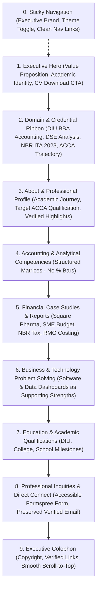

# Product Requirements Document (PRD)
## Siam's Accounting-Focused Hybrid Professional Portfolio

**Document Version:** 1.2.0  
**Phase:** Phase 2.1: Content Integrity Validation & Planning Corrections  
**Date:** October 10, 2026  
**Status:** Approved for Implementation Planning (Content Integrity Hardened)  
**Author:** Senior Product Manager, Accounting Career Portfolio Strategist, & Frontend Solution Architect  
**Repository:** [https://github.com/ibna-siam/Portfolio](https://github.com/ibna-siam/Portfolio)  

---

## 1. Product Overview

### 1.1 Product Vision & Purpose
To build a modern, high-credibility, and technically refined personal portfolio that establishes **Md Ibna Siam** as a high-potential **Accounting & Finance student developing practical professional capabilities**, working toward **ACCA** as a career target, with business management, financial technology, automation, dashboards, and software problem-solving as supporting strengths.

The portfolio bridges the gap between undergraduate academic study and professional practice. It showcases Siam's ability to analyze financial disclosures, build multi-period forecast models, navigate Bangladesh taxation frameworks (Income Tax Act 2023), perform variance and cost accounting analyses, and evaluate internal controls—while utilizing technology and software to automate and scale business solutions.

### 1.2 Problem Statement
The existing codebase was initialized from a generic software developer template (*"Alex Morgan - Portfolio"*). It suffers from:
1. **Developer Stereotyping:** Uses terminal monospace styling (`> [typedText] |`), developer buzzwords, and code-centric aesthetics that fail to appeal to corporate accounting and audit recruitment teams.
2. **Boilerplate Remnants:** Generic HTML title (`portfolio`), missing meta tags, broken external social links (`twitter.com`), and an oversized 378 KB favicon.
3. **Artificial Performance Delay:** A 1.6-second `setTimeout` render blocker that suppresses the `<main>` DOM and damages user experience and search engine indexing.
4. **Subjective Competency Metrics:** Arbitrary percentage progress meters (`88% Financial Accounting`) that undermine technical credibility.
5. **Monolithic Case Study Presentation:** A 736-line component (`Projects.jsx`) embedding nested, non-shareable modals that cause mobile scroll issues.
6. **Unvalidated Narrative Outcomes:** Coursework entries claiming corporate savings (e.g., claiming an academic student ratio project "saved 8% overhead" for a publicly traded corporation) or containing internal mathematical inconsistencies.

### 1.3 Target Audiences & Personas
1. **Audit & Assurance / Professional Advisory Firms (ACCA Approved Employers / Accounting firms):**  
   *Needs:* High attention to detail, adherence to standards (IFRS, IAS, BSA), analytical rigor, audit trail understanding, and professional integrity.
2. **Corporate Finance & Accounting Teams (MNCs, FMCG, Pharma, RMG):**  
   *Needs:* Practical fluency in financial statement analysis, cost sheet preparation, variance tracking, cash flow forecasting, and ERP/Excel modeling.
3. **Accounting & Finance Internship Recruiters:**  
   *Needs:* Immediate evidence of practical coursework application, coachability, foundational knowledge, and high computer literacy.
4. **Tech-Forward Enterprises & Commercial Operations:**  
   *Needs:* Numerically literate business analysts who can bridge business operations and software tools.
5. **Academic Mentors & Professional Collaborators:**  
   *Needs:* Transparent presentation of academic achievements and verifiable research.

### 1.4 Professional Positioning
> **"Accounting & Finance Professional in Development, Targeting ACCA Qualification, with Business & Technology Problem-Solving Skills."**

- **Primary Focus (75% content weight):** Financial Accounting, Managerial & Cost Accounting, Auditing & Internal Controls, Taxation & VAT (Bangladesh Framework), Financial Statement & Ratio Analysis.
- **Career Direction / Target Qualification:** **ACCA** (Association of Chartered Certified Accountants).  
  *Mandatory ACCA Integrity Rule:* ACCA must be presented strictly as a career direction or target qualification, **not** as an earned qualification. The portfolio must **not** claim ACCA student, registered student, affiliate, exam completion, or membership status unless independently verified or explicitly confirmed by the owner. Placeholder: `[ACCA REGISTRATION / EXAM STATUS — OWNER TO CONFIRM]`.
- **Supporting Strengths (25% content weight):** Business Operations, Digital Marketing Analytics, Spreadsheet Modeling, Dashboards, and Software-Driven Problem Solving.
- **Strict Boundary:** The owner must **never** be presented as an experienced accountant, qualified auditor, registered tax professional, or certified professional unless verified evidence supports that claim. All qualifications must reflect verified academic standing at Daffodil International University.

### 1.5 Primary Use Cases
- **UC-01 (Recruiter Review):** A corporate recruiter reviews Siam's application, opens the portfolio link from a CV, reads his executive profile within 30 seconds, and downloads his academic CV.
- **UC-02 (Audit Case Study Inspection):** An audit manager inspects the Square Pharmaceuticals ratio analysis or Retail Internal Audit case study, verifies the methodology, reads the data tables, and reviews the risk recommendations.
- **UC-03 (Technical Verification):** A business operations hiring manager reviews how Siam uses technology, dashboards, and software tools to streamline financial or operational tasks.
- **UC-04 (Direct Inquiry):** A recruiter sends an interview invitation or internship inquiry via the accessible contact form or verified LinkedIn/email links.

### 1.6 Planning Performance Targets (Not Measured Baselines)
| Metric | Current Observed State (Phase 1 Audit) | Planning Target (Post-Implementation) | Evaluation Method |
|---|---|---|---|
| **First Contentful Paint (FCP)** | Blocked by artificial 1.6s timer | < 0.6s (on fast mobile connection) | Chrome DevTools Performance Trace |
| **Largest Contentful Paint (LCP)** | > 2.0s (artificially delayed) | < 1.2s | Production Build Web Vitals Audit |
| **Accessibility Compliance** | Form inputs lack explicit label associations | WCAG 2.1 Level AA (0 critical errors) | axe-core / Lighthouse A11y |
| **Primary JS Chunk Size** | 416.44 kB (monolithic bundle) | < 160 kB (entry chunk via code splitting) | Vite Rollup Output Inspection |
| **Brand Clarity** | Developer template cliches present | 100% Accounting-Aligned First Fold | Reviewer / Recruiter Assessment |
| **Broken / Placeholder Links** | 1 placeholder link (`twitter.com`) | 0 broken or placeholder links | Automated Link Verification |

---

## 2. Brand & Content Strategy

### 2.1 Core Knowledge & Domain Pillars
The portfolio organizes Siam's capabilities into six structured domains:

```
┌────────────────────────────────────────────────────────────────────────┐
│                        CORE DOMAINS (75% Weight)                       │
├────────────────────────┬───────────────────────┬───────────────────────┤
│  Financial Statement   │   Cost & Management   │  Auditing & Internal  │
│        Analysis        │       Accounting      │        Control        │
├────────────────────────┼───────────────────────┼───────────────────────┤
│      Taxation & NBR    │   Corporate Finance   │   Macroeconomic &     │
│        Compliance      │      & Budgeting      │   Industry Research   │
└────────────────────────┴───────────────────────┴───────────────────────┘
                                    │
                                    ▼
┌────────────────────────────────────────────────────────────────────────┐
│                     SUPPORTING STRENGTHS (25% Weight)                  │
├───────────────────────────────────────┬────────────────────────────────┤
│    Business & Financial Modeling      │   Technology & Automation      │
│      (Excel, Tally ERP, Sheets)       │  (Web Apps, Dashboards, Data)  │
└───────────────────────────────────────┴────────────────────────────────┘
```

1. **Financial Statement Analysis:** 3-statement analysis, horizontal & vertical common-size statements, liquidity, solvency, profitability, and operational efficiency ratios.
2. **Cost & Management Accounting:** Prime cost, factory cost, overhead allocation (machine/labor hour absorption rates), Cost-Volume-Profit (CVP) analysis, and break-even calculations.
3. **Auditing & Internal Controls:** Internal audit planning, risk assessment matrices (Likelihood vs. Impact), cash control testing, physical inventory verification, and segregation of duties.
4. **Taxation & Regulatory Framework:** Bangladesh Income Tax Act 2023, individual salary return preparation (IT-11GA form), allowable deductions, investment tax rebates, and TDS reconciliation.
5. **Corporate Finance & Budgeting:** Master budget preparation, direct material/labor budgeting, cash deficit identification, seasonal cash flow forecasting, and sensitivity analysis.
6. **Technology-Driven Financial Problem Solving:** Structured spreadsheets, analytical tools, dashboards, web applications, and automation scripts that optimize business decision-making.

### 2.2 Tone of Voice & Linguistic Standards
- **Style:** Objective, analytical, evidence-based, articulate, and understatedly confident.
- **Terminology:** Use authentic accounting terminology (*"Horizontal trend analysis"*, *"Direct material absorption"*, *"Segregation of duties"*, *"Allowable investment rebate"*, *"Working capital cycle"*).
- **Prohibited Phrasing:** Avoid developer slang (*"10x dev"*, *"ninja"*), informal academic claims (*"know everything about finance"*), or unverified professional credentials (*"certified auditor"*, *"qualified ACCA member"*).

---

## 3. Information Architecture & Section Specifications

The proposed homepage hierarchy balances executive credibility, domain proof, and supporting technical capabilities:



### 3.1 Section Specifications

#### Section 1: Executive Hero
- **Purpose:** Make an immediate, high-trust first impression establishing Siam's academic focus and analytical strengths.
- **Content Requirements:**
  - Professional portrait of Siam ([src/assets/siam.jpeg](file:///d:/Project/portfolio%20siam/src/assets/siam.jpeg)).
  - Status indicator: *"BBA in Accounting Student · Daffodil International University"*.
  - Headline: *"Accounting & Finance Professional in Development"*.
  - Subtitle: *"Focused on financial reporting, cost accounting, taxation, and auditing, targeting ACCA qualification, with practical skills in business management and technology."*
  - Primary Action: *"Download Academic CV"* (Verified Google Drive PDF link).
  - Secondary Action: *"Explore Case Studies"* (Anchor scroll to `#projects`).
  - Professional Links: Verified GitHub (`https://github.com/ibna-siam`) and owner-confirmed LinkedIn (`https://www.linkedin.com/in/ibnasiam/`).
- **Mobile Behavior:** Single-column layout; text content appears first, followed by avatar container. Rotating decorative ring simplified to prevent mobile CPU throttling.

#### Section 2: Domain & Credential Ribbon
- **Purpose:** Instant visual proof of core curriculum and research areas.
- **Content Requirements:** Badges featuring `DSE Financial Statement Analysis`, `NBR Income Tax Act 2023`, `Master Budgeting & Forecasting`, `Internal Audit & Controls`, `CVP & Cost Allocation`, `Target: ACCA Pathway`.
- **Mobile Behavior:** Horizontal scrollable ribbon or 2x2 wrapping badge grid.

#### Section 3: About & Professional Profile
- **Purpose:** Communicate personal backstory, academic rigor, ethical grounding, and long-term career ambition.
- **Content Requirements:**
  - Executive narrative outlining passion for accounting accuracy and business viability.
  - Clear statement of career direction: Pursuing undergraduate BBA in Accounting with a future career direction toward **ACCA** (Association of Chartered Certified Accountants) and corporate finance.
  - Mandatory disclaimer: ACCA presented strictly as a career direction or target qualification; no unverified completion or student status claimed.
  - **Evidence-Based Profile Highlights (Replacing Decorative Vanity Metric Cards):**
    - *Academic Status:* Undergraduate BBA in Accounting Candidate at Daffodil International University.
    - *Core Focus:* Financial Reporting, Cost & Management Accounting, Taxation (NBR ITA 2023), Auditing.
    - *Portfolio Depth:* 5 Applied Accounting Case Studies & 3 Secondary Economic Research Studies.
    - *Professional Target:* Preparing for ACCA Professional Qualification.
- **Mobile Behavior:** Highlights stack cleanly into structured analytical cards.

#### Section 4: Accounting & Analytical Competencies
- **Purpose:** Display skills categorized by domain competence rather than arbitrary percentage bars.
- **Content Requirements:**
  - Category 1: *Financial & Managerial Accounting* (Financial Reporting, Cost Sheets, CVP Analysis, Cash Flow Projections, Working Capital).
  - Category 2: *Taxation & Regulatory Frameworks* (NBR Guidelines, Income Tax Act 2023, IT-11GA Return Filing, VAT Basics).
  - Category 3: *Auditing & Governance* (Internal Control Testing, Risk Assessment Matrices, Segregation of Duties, Audit Working Papers).
  - Category 4: *Software, Systems & Technology* (Advanced Microsoft Excel, Tally ERP, QuickBooks Basics, Web & Data Tools).
  - Supporting Tags: Specific framework badges (*IFRS*, *IAS*, *BAS*, *NBR ITA 2023*).
- **Mobile Behavior:** Grid collapses to single-column card stack; pill tags wrap comfortably with ample touch spacing.

#### Section 5: Financial Case Studies & Reports (Core Showcase)
- **Purpose:** Present Siam's 8 academic research projects as in-depth, executive-grade case studies with strict evidentiary labeling.
- **Content Requirements:**
  - Category filter: *All*, *Financial Analysis*, *Budgeting & Planning*, *Taxation*, *Cost Accounting*, *Auditing*, *Economic Research*.
  - Featured Case Study 1: **Square Pharmaceuticals Ltd.** — 3-Year Trend & Ratio Analysis (2021–2023). Explicitly labeled as an academic secondary analysis of public DSE disclosures. Unsubstantiated corporate savings claims removed.
  - Featured Case Study 2: **AgroFab Ltd.** — Master Budget & 12-Month Cash Flow Plan for Manufacturing SME. Labeled as an educational simulation.
  - Featured Case Study 3: **Individual Income Tax Return** — NBR ITA 2023 IT-11GA Computation. Labeled as an academic compliance study with reconciled tax schedules.
  - Featured Case Study 4: **StyleTex Ltd.** — RMG Factory Cost Sheet, Overhead Absorption & Product Mix CVP. Labeled as an educational costing model with reconciled CVP contribution calculations.
  - Featured Case Study 5: **DhakaShop Ltd.** — Retail Internal Audit & 5-Point Control Weakness Matrix. Labeled as a simulated audit engagement.
  - Academic Research Studies 6–8: FIFA World Cup Economic Impact, Bangladesh Digital Economy, Macroeconomic Inflation & Business Cycles. Secondary macroeconomic papers citing BBS, Bangladesh Bank, and EPB data.
  - Interactive Action: Clicking a card opens a dedicated **Case Study Viewer** showing Problem Statement, Methodology, Financial Tables, and Strategic Recommendations.
- **Mobile Behavior:** Cards collapse to single column. In the Case Study Viewer, financial tables have horizontal swipe indicators with sticky row headers.

#### Section 6: Business & Technology Problem Solving (Supporting Strengths)
- **Purpose:** Demonstrate practical technology, automation, dashboards, and software capabilities applied to business, commercial, and financial problems.
- **Content Requirements:**
  - Case cards highlighting business/tech projects (e.g., Financial Modeling Workbooks, E-Commerce Platform Analytics, Business Dashboards).
  - Clear explanation of the business problem solved, tech stack used, and financial relevance.
  - Live links and GitHub repository links where verified.
- **Visual Weight:** Secondary to the accounting showcase (2–3 curated items max).

#### Section 7: Education & Academic Qualifications
- **Purpose:** Detail academic milestones, institutions, and coursework foundations.
- **Content Requirements:**
  - Milestone 1: **Bachelor of Business Administration (BBA) in Accounting**, Daffodil International University (2025 — Present). Highlights: Birulia Campus, core courses in Financial Accounting, Auditing, Corporate Finance, and Macroeconomics. Graduation date: `[GRADUATION DATE — OWNER TO CONFIRM]`. Academic GPA: `[ACADEMIC RESULT / CGPA — OWNER TO CONFIRM]`.
  - Milestone 2: **Higher Secondary Certificate (HSC)**, Ghatail Cantonment Public School & College (2022 — 2024), Business Studies Group. GPA: `[HSC RESULT / GPA — OWNER TO CONFIRM]`.
  - Milestone 3: **Secondary School Certificate (SSC)**, Ghatail Govt. Pilot High School (2020 — 2022), Business Studies Group. GPA: `[SSC RESULT / GPA — OWNER TO CONFIRM]`.
- **Mobile Behavior:** Vertical timeline with left-aligned continuous line and circular milestone badges.

#### Section 8: Professional Inquiries & Contact
- **Purpose:** Provide frictionless, accessible channels for recruiters and collaborators to reach Siam.
- **Content Requirements:**
  - Verified University Contact Email: `252-58-083@diu.edu.bd` (verified in source code; preserved exactly as requested).
  - Phone: `[PHONE NUMBER — OWNER CONFIRMATION REQUIRED TO PUBLISH]`. (Phone number exists in source data, but explicit publication consent on the live site is required).
  - Verified LinkedIn: `https://www.linkedin.com/in/ibnasiam/` (owner-confirmed).
  - Location: `Dhaka, Bangladesh`.
  - Professional availability notice: *"Open for Accounting & Finance Internships, Trainee Roles, and Academic Collaborations."*
  - Secure Contact Form: Name, Email, Subject/Inquiry Type (Recruitment / Academic / General), Message.
  - Formspree endpoint integration (`https://formspree.io/f/mjgzqeeg`) preserved with `try...catch` error resilience and success confirmation state.
- **Mobile Behavior:** Full-width form fields with minimum 44px touch targets; virtual keyboard optimizations (`type="email"`, `inputMode="email"`).

#### Section 9: Footer & Colophon
- **Purpose:** Elegant closure with copyright, tech attribution, verified social links, and smooth back-to-top interaction.

---

## 4. Functional Requirements

### 4.1 Feature Traceability Matrix (Existing vs. Proposed)

| Feature ID | Feature Name | Existing State (Phase 1) | Proposed State (Phase 2 PRD) | Priority |
|---|---|---|---|---|
| **FR-01** | **Theme Toggle** | Functional (`useTheme`, localStorage + prefers-color-scheme) | **Preserve & Refine:** Keep functional toggle; eliminate duplicate CSS class mounting on root wrapper. | Must Have |
| **FR-02** | **Navigation & Active Highlighting** | Functional (`useActiveSection`, `IntersectionObserver`) | **Preserve & Refine:** Update nav labels to reflect new hierarchy; add `aria-expanded` and Escape key listener for mobile drawer. | Must Have |
| **FR-03** | **Splash Screen & Loader** | Artificial 1.6s blocking `setTimeout` in [App.jsx](file:///d:/Project/portfolio%20siam/src/App.jsx) | **Overhaul:** Remove artificial 1.6s delay; render `<main>` immediately; replace with smooth non-blocking entrance transition. | Must Have |
| **FR-04** | **Skills Section Display** | Arbitrary numerical percentage progress bars | **Overhaul:** Replace percentage bars with structured competency grids, course tags, and regulatory badges. | Must Have |
| **FR-05** | **Case Study Presentation** | 736-line monolithic modal-inside-modal in [Projects.jsx](file:///d:/Project/portfolio%20siam/src/components/Projects.jsx) | **Refactor:** Decompose into modular components; direct case study viewer with deep-linking hash support (`#project-1`). | Must Have |
| **FR-06** | **Category Filtering** | Basic state filter across 7 categories | **Preserve & Enhance:** Maintain snappy client-side filtering with animated layout transitions. | Should Have |
| **FR-07** | **CV Download / View** | Links directly to Google Drive URL | **Preserve & Enhance:** Maintain verified Google Drive URL; add clear PDF indicator badge and file size metadata. | Must Have |
| **FR-08** | **Contact Form Submission** | Unprotected Formspree fetch without `try...catch` | **Harden:** Wrap in `try...catch`; add client validation, honeypot spam protection, and inline network error banner while preserving existing Formspree endpoint (`mjgzqeeg`). | Must Have |
| **FR-09** | **Form Accessibility** | Labels lack `htmlFor`, inputs lack `id` | **Harden:** Add explicit `id` and `htmlFor` pairings; add `aria-required` and `aria-invalid`. | Must Have |
| **FR-10** | **Professional Links** | 1 broken placeholder (`twitter.com`), verified LinkedIn | **Fix:** Set LinkedIn strictly to owner-confirmed `https://www.linkedin.com/in/ibnasiam/`; remove placeholder `twitter.com`. | Must Have |
| **FR-11** | **Tech Hybrid Showcase** | Missing entirely (0 tech projects shown) | **New:** Add dedicated supporting section showcasing dashboards, automation, and software problem-solving. | Should Have |

---

## 5. Non-Functional Requirements

### 5.1 Mobile-First Responsiveness
- All views must be fully operational and aesthetically balanced across breakpoints:
  - Mobile compact: `320px – 480px`
  - Mobile large / Phablet: `481px – 640px`
  - Tablet: `641px – 1024px`
  - Desktop: `1025px – 1440px`
  - Ultrawide: `> 1440px` (contained within `max-w-6xl` / 1152px)
- Zero unintended horizontal viewport overflow (`overflow-x: clip` on root).
- Minimum touch target size for interactive controls: **44 x 44 px** (WCAG 2.5.5).

### 5.2 Accessibility (WCAG 2.1 Level AA)
- **Color Contrast:** All body text must maintain a minimum contrast ratio of **4.5:1** against backgrounds; large text (18pt / 24px+) must achieve at least **3:1**.
- **Keyboard Navigation:** Full tab navigation support with visible high-contrast focus rings (`focus-visible:ring-2 focus-visible:ring-accent-500`).
- **Semantic HTML:** Strict document hierarchy (single `<h1>` in Hero, section headers `<h2>`, card titles `<h3>`).
- **Screen Reader Support:** All icon buttons (`aria-label`), modal dialogs (`role="dialog"`, `aria-modal="true"`, `aria-labelledby`), and form inputs must be fully accessible.
- **Reduced Motion:** Respect `prefers-reduced-motion: reduce` by disabling non-essential decorative animations and reducing transitions to subtle fades.

### 5.3 Performance & Core Web Vitals
- **Bundle Optimization:** Configure Rollup `manualChunks` in [vite.config.js](file:///d:/Project/portfolio%20siam/vite.config.js) to isolate heavy vendor chunks (`framer-motion`, `react-icons`), targeting initial entry bundle below **160 kB** gzip.
- **Zero Artificial Delays:** Eliminate the 1.6s timeout in `App.jsx`.
- **Image Optimization:** Compress profile image (`siam.jpeg`) into modern WebP format; replace oversized 378 KB `favicon.png` with lightweight `< 15 KB` multi-resolution assets.
- **Font Optimization:** Google Fonts loaded with `font-display: swap` to prevent FOIT (Flash of Invisible Text).

### 5.4 SEO & Social Sharing Metadata
- Document title: `Md Ibna Siam | Accounting & Finance Portfolio`
- Meta Description: `Academic and professional portfolio of Md Ibna Siam — BBA in Accounting student at Daffodil International University targeting ACCA qualification, specializing in financial reporting, auditing, taxation, and business technology.`
- Canonical URL: Explicitly defined based on approved Vercel production hosting.
- Open Graph & Twitter Cards: Full tags (`og:title`, `og:description`, `og:image`, `og:url`, `twitter:card`) ensuring professional preview embeds on LinkedIn, WhatsApp, and social platforms.

### 5.5 Production Deployment & Hosting Architecture
- **Preferred Hosting Platform:** **Vercel** (Confirmed by Owner).
  - Existing repository contains `.vercel/` project link and `@vercel/speed-insights`.
  - Deployment configuration in Vite: `base: '/'` is standard for Vercel root hosting.
- **Identified Hosting Conflict (For Implementation Phase):**  
  `package.json` contains `"homepage": "https://ibna-siam.github.io/Portfolio"` and `"deploy": "gh-pages -d dist"`. This conflict is formally recorded as a finding to be resolved during **Phase 3 / Phase 9** (by cleaning up conflicting `gh-pages` scripts while preserving the existing Vercel deployment pipeline). In accordance with Phase 2 rules, **no deployment configuration files are modified during Phase 2**.
- **Stack Preservation:** The application will remain on its existing stack (React, Vite, Tailwind CSS, Framer Motion) without introducing an external backend or database.

---

## 6. Content Integrity & Ethics Framework

1. **Strict Evidence-Based Claims:** No unearned credentials, licenses, or professional titles shall be used.
2. **ACCA Regulatory Guardrail:** ACCA is strictly presented as a **target qualification / career trajectory**. The portfolio must not claim that Siam is an ACCA member, affiliate, registered student, or has passed specific applied knowledge/skills exams until confirmed with documentation. Placeholder: `[ACCA REGISTRATION / EXAM STATUS — OWNER TO CONFIRM]`.
3. **Academic & Simulation Transparency:** Case studies utilizing simulated corporate data (e.g., StyleTex Ltd. RMG factory, AgroFab Ltd. SME, DhakaShop Ltd. retail audit) must be explicitly designated as **"Academic Case Study"** or **"Simulated Practical Engagement"**.
4. **Public Disclosures Context:** The Square Pharmaceuticals analysis must cite publicly available annual reports published via the Dhaka Stock Exchange (DSE) disclosure portal. Unsubstantiated claims of having achieved operational savings for Square Pharmaceuticals must not be made.
5. **Taxation Accuracy:** The NBR income tax simulation must explicitly cite the **Income Tax Act 2023 (ITA 2023)** and assessment year parameters without claiming to represent a real individual's private tax filing. The tax schedule figures must be mathematically reconciled before publication.
6. **Contact Publication Consent:** Personal phone number publication requires explicit confirmation (`[PHONE NUMBER — OWNER CONFIRMATION REQUIRED TO PUBLISH]`).
7. **Unknown Information Policy:** Explicit placeholders (`[OWNER TO CONFIRM]`) are mandatory for all unverified dates, GPAs, certifications, and external affiliations.
