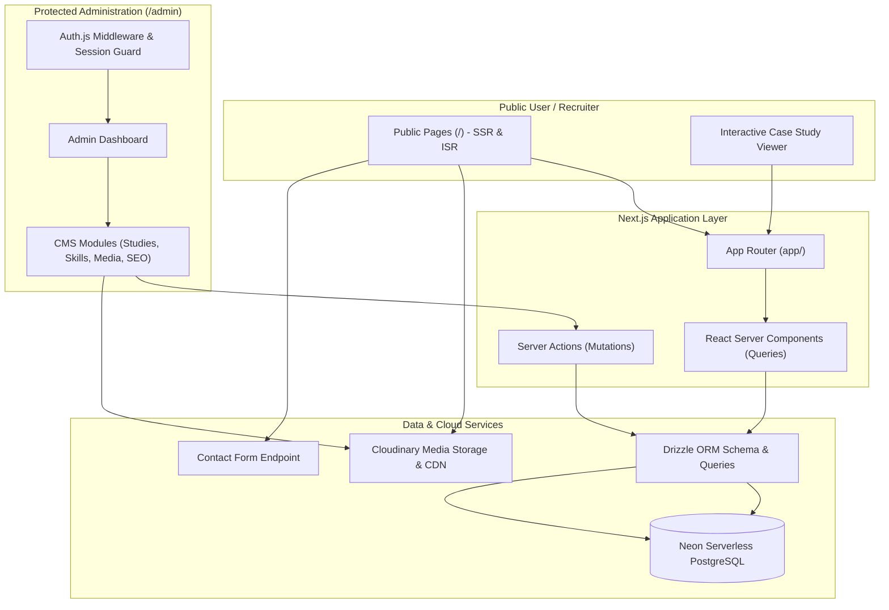
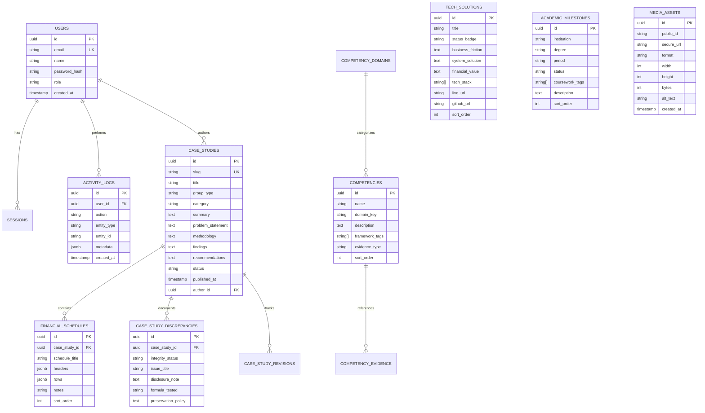

# Product Requirements Document (PRD)
## Siam's Accounting-Focused Hybrid Professional Portfolio & Portfolio CMS

**Document Version:** 2.0.0  
**Phase:** Phase 0: Portfolio CMS Documentation Audit & Alignment  
**Date:** October 21, 2026  
**Status:** Approved for Implementation Planning (Full Portfolio CMS Architecture)  
**Author:** Senior Product Manager, Accounting Career Portfolio Strategist, & Full-Stack Solutions Architect  
**Repository:** [https://github.com/ibna-siam/Portfolio](https://github.com/ibna-siam/Portfolio)  
**Production Site:** [https://ibnasiam.vercel.app/](https://ibnasiam.vercel.app/)  

---

## 1. Product Overview

### 1.1 Product Vision & Strategic Evolution
To evolve the existing, high-credibility personal portfolio of **Md Ibna Siam** from a static client-side single-page application into an **enterprise-grade, full-stack Portfolio CMS** with a secure, authenticated **Admin Panel** (`/admin`).

The platform establishes Md Ibna Siam as a high-potential **Accounting & Finance professional in development**, actively targeting **ACCA** (Association of Chartered Certified Accountants) qualification as a career milestone, with practical capabilities in financial reporting, cost accounting, Bangladesh taxation (Income Tax Act 2023), auditing, and internal controls—complemented by business management, financial technology, automation, dashboards, and software problem-solving.

This is an **evolution of an existing production project** currently deployed at `https://ibnasiam.vercel.app/`, not a greenfield initiative. All verified content, academic case studies, financial schedules, integrity audit disclosures, and design rigor developed in previous phases must be preserved and elevated within the new architecture.

### 1.2 Problem Statement & Motivation for CMS Evolution
The existing client-side React/Vite implementation succeeded in establishing domain substance, eliminating developer cliches, and hardening financial integrity. However, as an evolving professional asset, it presents several key architectural constraints:
1. **Hardcoded In-Memory Content:** All academic case studies, financial tables, competencies, and milestones are coupled to static JavaScript files (`src/data/*.js`). Adding or updating research papers, semester coursework, or professional achievements requires manual code edits, local builds, and git deployments.
2. **Lack of Content Lifecycle (Draft / Preview / Publish):** Uncompleted research or drafts currently cannot be previewed in a staging state or scheduled without exposing them in production.
3. **No Centralized Media Management:** Profile portraits and documents reside either as local static assets or external Google Drive links without optimized cloud transformations, responsive breakpoints, or asset versioning.
4. **Static SEO & Social Discovery:** Client-rendered SPAs cannot provide dynamic server-generated Open Graph cards or fine-grained server-rendered JSON-LD schema per individual case study.
5. **Absence of Auditability & Revisions:** No administrative audit log exists to track revisions, record why financial figures were updated, or maintain historical snapshots of academic analyses.

### 1.3 Target Audiences & Personas
1. **Audit & Assurance / Professional Advisory Firms (ACCA Approved Employers / Top Accounting Firms):**  
   *Needs:* High attention to detail, adherence to standards (IFRS, IAS, BSA, ITA 2023), analytical rigor, audit trail understanding, and professional integrity.
2. **Corporate Finance & Accounting Teams (MNCs, FMCG, Pharma, RMG):**  
   *Needs:* Practical fluency in financial statement analysis, cost sheet preparation, variance tracking, cash flow forecasting, and ERP/Excel modeling.
3. **Accounting & Finance Internship Recruiters:**  
   *Needs:* Immediate evidence of practical coursework application, coachability, foundational knowledge, and high computer literacy.
4. **Tech-Forward Enterprises & Commercial Operations:**  
   *Needs:* Numerically literate business analysts who can bridge business operations, financial data, and software systems.
5. **Portfolio Owner & Administrator (Md Ibna Siam):**  
   *Needs:* A secure, intuitive, and tactile Admin Panel to author case studies, update academic progress, upload documents/media, manage SEO, and toggle publishing states without modifying code.

### 1.4 Professional Positioning & Ethical Guardrails
> **"Accounting & Finance Professional in Development, Targeting ACCA Qualification, with Business & Technology Problem-Solving Skills."**

- **Primary Focus (75% content weight):** Financial Accounting, Managerial & Cost Accounting, Auditing & Internal Controls, Taxation & VAT (Bangladesh Framework), Financial Statement & Ratio Analysis.
- **Career Direction / Target Qualification:** **ACCA** (Association of Chartered Certified Accountants).  
  *Mandatory ACCA Integrity Rule:* ACCA must be presented strictly as a career direction or target qualification, **not** as an earned qualification. The portfolio must **not** claim ACCA student, registered student, affiliate, exam completion, or membership status unless independently verified or explicitly confirmed by the owner. Placeholder: `[ACCA REGISTRATION / EXAM STATUS — OWNER TO CONFIRM]`.
- **Supporting Strengths (25% content weight):** Business Operations, Digital Marketing Analytics, Spreadsheet Modeling, Dashboards, and Software-Driven Problem Solving.
- **Strict Boundary:** The owner must **never** be presented as an experienced accountant, qualified auditor, registered tax professional, or certified professional unless verified evidence supports that claim. All qualifications must reflect verified academic standing at Daffodil International University.
- **Privacy Enforcement:** Personal phone numbers (`+880 1841-380687`) remain strictly isolated from public surfaces; official university email (`252-58-083@diu.edu.bd`) and verified LinkedIn profile serve as primary direct contact channels.

---

## 2. Approved Technology Stack & Architecture

### 2.1 Core Technology Decisions
The Full Portfolio CMS will be built upon modern, robust, and cost-effective technologies:

| Layer | Approved Technology | Purpose & Rationale |
|---|---|---|
| **Framework** | **Next.js (App Router)** | Full-stack React framework providing Server Components (RSC), Server Actions for mutation, dynamic routing, and fast initial page loads. |
| **Database** | **Neon PostgreSQL** | Serverless PostgreSQL with auto-scaling, branching, and connection pooling via `@neondatabase/serverless`. |
| **ORM** | **Drizzle ORM** | Type-safe, lightweight, SQL-like TypeScript ORM offering fast query execution and clean schema migrations. |
| **Authentication** | **Auth.js (NextAuth v5)** | Battle-tested session management and authentication for the protected `/admin` route with credentials and OAuth provider options. |
| **Media Storage & Delivery** | **Cloudinary** | Cloud-based image/asset storage, automatic WebP/AVIF format optimization, responsive resizing, and secure signed uploads. |
| **Styling & Design** | **Tailwind CSS + Executive Claymorphism** | Tactile, 3D soft-shadowed surfaces with inner highlights, paired with authoritative navy/slate foundation and emerald accents. |
| **Hosting & Deployment** | **Vercel** | Native hosting platform for Next.js with edge caching, automated branch previews, and Speed Insights analytics. |

### 2.2 Conceptual System Architecture


---

## 3. Scope & Detailed Functional Requirements

### 3.1 Public Portfolio Experience (Preserved & Enhanced)
The public interface preserves all 6 core sections while migrating from client-side state to server-rendered Next.js components:

1. **Executive Sticky Navigation:**
   - Semantic nav links: `About`, `Competencies`, `Case Studies`, `Solutions`, `Education`, `Contact`.
   - Dark/Light mode toggle with persistence and system preference synchronization.
   - Direct link to `/admin` login (subtle, accessible entry or discrete keybinding/footer link).
2. **Executive Hero Section:**
   - Editorial headline: *"Accounting & Finance Professional in Development"*.
   - Portrait asset delivered via Cloudinary with responsive sizing and high fetch priority (`fetchPriority="high"`).
   - Primary Action: *"Download Academic CV"* (Verified PDF delivery via Cloudinary/Drive).
   - Secondary Action: Smooth scroll to `#projects`.
   - 5-topic academic domain ribbon (`DSE Financial Analysis`, `NBR ITA 2023`, `Master Budgeting`, `Cost Accounting`, `Internal Audit`).
3. **About & Professional Profile:**
   - Clear academic narrative detailing DIU accounting coursework and ethical rigor.
   - Explicit ACCA career trajectory disclaimer.
   - 4 evidence-based factual highlight cards (Program, Disciplines, Portfolio Depth, ACCA Trajectory).
4. **Accounting & Analytical Competencies Matrix:**
   - Database-driven matrix rendered across 4 domains (Financial & Managerial Accounting, Taxation & NBR, Auditing & Governance, Software & Systems).
   - Client-side tab filters (`All`, `Accounting`, `Taxation`, `Software`) without layout shift.
   - Distinct framework badges (`IFRS / BAS`, `Income Tax Act 2023`, `CVP Analysis`).
5. **Financial Case Study Showcase & Interactive Viewer:**
   - Group A (5 Applied Accounting Case Studies) & Group B (3 Macroeconomic Papers).
   - Dedicated interactive modal/drawer viewer with 5 distinct tabs: Overview, Methodology, Financial Data Schedules (`.tabular-nums`), Findings, and Integrity Disclosures.
   - URL hash deep-linking (`#case-study-[slug]`) for direct recruiter bookmarking.
   - Transparent display of the 4 mandatory discrepancy disclosures (Individual Tax, StyleTex CVP, FIFA World Cup, Square Pharma).
6. **Business & Technology Solutions (~25% Supporting Weight):**
   - 3 curated problem-solving showcases (Executive Financial Portfolio, Digital Mess Reconciliation System, Personal Cash Flow Allocation Tool).
   - Clear problem-solution-impact format with status badges (`Production Ready`, `Operational Prototype`, `Functional Prototype`).
7. **Education & Academic Progression Timeline:**
   - Confirmed milestones: DIU BBA in Accounting (2025–Present), HSC Business Studies (2022–2024), SSC Business Studies (2020–2022).
   - ACCA Career Trajectory roadmap card.
8. **Contact & Professional Inquiries:**
   - Verified official email: `252-58-083@diu.edu.bd` with one-click copy button.
   - Formspree endpoint integration (`mjgzqeeg`) with accessible inline validation and confirmation.
   - Social links: verified LinkedIn and GitHub; personal phone strictly excluded.
9. **Executive Footer & Colophon:**
   - Copyright, back-to-top smooth scrolling, canonical links, and security colophon.

---

### 3.2 Portfolio CMS & Admin Panel Modules (`/admin`)

#### 3.2.1 Authentication & Security (`/admin/login`, `/admin/*`)
- **Framework:** Auth.js (NextAuth v5) with secure HTTP-only cookies and JWT/database session strategy.
- **Access Control:** Restricted to authorized administrator(s) via secure credentials or OAuth (GitHub/Google).
- **Protection Boundaries:**
  - Next.js Middleware guarding all routes matching `/admin/:path*` (except `/admin/login`).
  - Automatic session timeout and CSRF token verification on all mutations.
  - Rate limiting on login attempts to mitigate brute-force vectors.

#### 3.2.2 Publishing Workflow (Draft → Preview → Publish)
All major content entities (Case Studies, Tech Solutions, Academic Notes) adhere to a 3-tier publishing lifecycle:
1. **Draft:** Saved in Neon PostgreSQL with `status = 'draft'`. Inaccessible to the public; visible only in Admin.
2. **Preview:** Protected Next.js Draft Mode (`/api/draft?secret=...&slug=...`) enabling the administrator to preview unpublished drafts within the authentic public page layout.
3. **Published:** Live in production with `status = 'published'`, indexed by search engines and displayed on public routes.
4. **Archived:** Soft-deleted or unlisted without destroying historical data records (`status = 'archived'`).

#### 3.2.3 Admin Modules Breakdown

```
┌────────────────────────────────────────────────────────────────────────┐
│                        PORTFOLIO CMS ADMIN MODULES                     │
├────────────────────────┬───────────────────────┬───────────────────────┤
│  1. Dashboard Overview │  2. Case Studies &    │  3. Competencies &    │
│     & Quick Stats      │     Reports Manager   │     Skill Matrix      │
├────────────────────────┼───────────────────────┼───────────────────────┤
│  4. Academic Journey   │  5. Tech Solutions    │  6. Profile & Bio     │
│     & Timeline Manager │     Showcase Manager  │     Configuration     │
├────────────────────────┼───────────────────────┼───────────────────────┤
│  7. Media & Asset      │  8. SEO & Social      │  9. Revision History  │
│     Library (Cloud)    │     Metadata Manager  │     & Activity Logs   │
└────────────────────────┴───────────────────────┴───────────────────────┘
```

1. **Dashboard Overview (`/admin`):**
   - Summary statistics: total case studies, drafts in progress, published studies, media storage usage, recent activity feed.
   - Quick actions: "Create New Case Study", "Upload Asset", "Preview Site", "View Live Site".
2. **Case Studies & Reports Manager (`/admin/case-studies`):**
   - Full CRUD interface for financial research papers and accounting case studies.
   - Fields: Title, Slug, Group (Applied Accounting vs Macroeconomic), Category, Discipline, Executive Summary, Problem Statement, Methodology, Findings, Recommendations, Evidentiary Status (`Verified`, `Academic Calculation`, `Requires Reconciliation`, `Illustrative`).
   - Dynamic Financial Data Schedule Builder: Add/edit structured tables with row labels, multi-year columns, tabular numbers, and notes.
   - Discrepancy & Integrity Register Editor: Explicitly record formulas tested, discrepancies identified, and preservation policies.
   - Publishing controls: Status selector (Draft, Preview, Published), published timestamp, author.
3. **Competencies & Skill Matrix Manager (`/admin/competencies`):**
   - Manage the 16+ core competencies across 4 domains.
   - Fields: Competency Name, Category, Domain, Description, Framework Tags (e.g. `IFRS`, `ITA 2023`), Evidence Type, Linked Case Study references, Display Order.
4. **Academic Journey & Timeline Manager (`/admin/academic-journey`):**
   - Manage educational milestones and ACCA trajectory cards.
   - Fields: Institution, Degree/Certificate, Period, Status, Verified Coursework Tags, Academic Focus, Display Order.
5. **Business & Technology Solutions Manager (`/admin/tech-solutions`):**
   - Manage the supporting ~25% weight technology projects.
   - Fields: System Title, Category, Status Badge (`Deployed`, `Operational Prototype`, `Functional Prototype`), Business Friction, System Architecture, Financial Value, Tech Stack Tags, Live URL, GitHub URL.
6. **Profile & Contact Configuration (`/admin/profile`):**
   - Centralized management of profile headline, bio narrative, academic affiliations, verified contact email, LinkedIn URL, GitHub URL, and CV document URL.
   - Guardrail setting: Phone number privacy enforcement toggle.
7. **Media & Asset Library (`/admin/media`):**
   - Cloudinary integration: Drag-and-drop file upload with signed API calls.
   - Image asset browsing, preview, metadata tagging, and copyable CDN URLs.
   - Automatic transformations: WebP/AVIF auto-format, quality optimization (`f_auto,q_auto`), thumbnail generation.
8. **SEO & Social Metadata Manager (`/admin/seo`):**
   - Global and per-route metadata controls: Page Titles, Meta Descriptions, Canonical URLs, Keywords.
   - Open Graph & Twitter card image selectors (linked to Cloudinary).
   - Structured Data (Schema.org `Person`, `EducationalOccupationalCredential`) preview and validation.
9. **Revision History & Activity Logs (`/admin/activity`):**
   - Automated append-only activity log recording entity mutations (Created, Updated, Published, Archived).
   - Captures timestamp, entity type, entity ID, action, and user email.
   - Rollback capability / historical snapshot comparison for case studies.

---

## 4. Database Schema Specifications (Neon PostgreSQL & Drizzle ORM)

The relational schema will be defined via Drizzle ORM in TypeScript, enforcing referential integrity and strict typing:



---

## 5. Non-Functional Requirements

### 5.1 Design & Visual Aesthetics: Executive Claymorphism
- **Public & Admin Interface Unity:** Both public showcase and admin surfaces follow the **Executive Claymorphism** design system.
- **Visual Characteristics:**
  - Tactile, pillowy 3D containers with soft double-drop shadows and subtle top-left inner highlights (`box-shadow: inset 1px 1px 2px rgba(...), 4px 6px 12px rgba(...)`).
  - High-end corporate palette: Executive Navy (`#0A0F1D`, `#0F172A`), Crisp Slate (`#F8FAFC`, `#F1F5F9`), Emerald Jade (`#059669`, `#10B981`), Amber Variance (`#D97706`).
  - Floating pill controls, extruded buttons with pressed depth states (`active:translate-y-0.5 active:shadow-inner`), and glassmorphic modal overlays (`backdrop-blur-md`).
  - Tabular financial numerals: `.tabular-nums` throughout schedules and metrics.
- **Theme Support:** Full dark mode and light mode parity with adaptive inner glow and clay depth shadows.

### 5.2 Accessibility (WCAG 2.1 Level AA)
- Minimum color contrast ratio of 4.5:1 for body copy and 3:1 for large display text and interactive focus indicators.
- Visible, high-contrast focus rings (`focus-visible:ring-2 focus-visible:ring-emerald-500`) across all interactive public and admin controls.
- Full keyboard operability: Tab stop sequences, Escape key modal dismiss, Arrow key tab switching.
- Screen reader ARIA compliance: `role="tablist"`, `role="tab"`, `role="tabpanel"`, `role="dialog"`, `aria-modal="true"`, `aria-invalid`, `aria-describedby`.
- Strict adherence to `prefers-reduced-motion: reduce` across all animations and transitions.

### 5.3 Performance & Core Web Vitals
- Next.js Server Components and selective client boundary (`"use client"`) utilization.
- Fast First Contentful Paint (FCP < 0.8s) and Largest Contentful Paint (LCP < 1.2s) on broadband and 4G connections.
- Zero Cumulative Layout Shift (CLS < 0.05) through explicit image dimensions and font optimization (`next/font/google`).
- Cloudinary auto-optimization (`q_auto,f_auto`) delivering modern WebP/AVIF images.

### 5.4 Security & Data Protection
- **No Client Credentials:** Database connection string, Auth.js secret, and Cloudinary API secret are strictly accessible in Node.js server environments; never exposed via `NEXT_PUBLIC_*`.
- **Zod Validation:** All Server Actions and API route inputs strictly validated using Zod schemas before database queries or mutations.
- **SQL Injection Prevention:** Parameterized queries enforced natively through Drizzle ORM.
- **Sanitization:** All rich markdown and user input sanitized to prevent Stored XSS attacks.
- **Rate Limiting:** Protection on authentication endpoints and public contact proxies.

---

## 6. Content Integrity & Ethics Framework (Preserved & Mandated)

1. **Strict Evidence-Based Claims:** No unearned credentials, licenses, or professional titles shall be used.
2. **ACCA Regulatory Guardrail:** ACCA is strictly presented as a **target qualification / career trajectory**. The portfolio must not claim that Siam is an ACCA member, affiliate, registered student, or has passed specific applied knowledge/skills exams until confirmed with documentation. Placeholder: `[ACCA REGISTRATION / EXAM STATUS — OWNER TO CONFIRM]`.
3. **Academic & Simulation Transparency:** Case studies utilizing simulated corporate data (e.g., StyleTex Ltd. RMG factory, AgroFab Ltd. SME, DhakaShop Ltd. retail audit) must be explicitly designated as **"Academic Case Study"** or **"Simulated Practical Engagement"**.
4. **Public Disclosures Context:** The Square Pharmaceuticals analysis must cite publicly available annual reports published via the Dhaka Stock Exchange (DSE) disclosure portal. Unsubstantiated claims of having achieved operational savings for Square Pharmaceuticals must not be made.
5. **Taxation Accuracy & Discrepancy Transparency:** The NBR income tax simulation must explicitly cite the **Income Tax Act 2023 (ITA 2023)**. Internal mathematical discrepancies in historical source data (Individual Tax net refund divergence, StyleTex RMG shirt contribution margin calculation, and FIFA World Cup direct vs total economic impact conflict) must **NOT** be silently changed; they must remain transparently disclosed via the Integrity Register until verified by the owner.
6. **Contact Publication Consent:** Personal phone number publication requires explicit confirmation (`[PHONE NUMBER — OWNER CONFIRMATION REQUIRED TO PUBLISH]`).
7. **Unknown Information Policy:** Explicit placeholders (`[OWNER TO CONFIRM]`) are mandatory for all unverified dates, GPAs, certifications, and external affiliations.

---

## 7. Feature Traceability Matrix (Current SPA vs. Target CMS)

| Feature ID | Feature Name | Current State (Vite SPA) | Target CMS State (Next.js + Neon + Drizzle) | Scope & Priority |
|---|---|---|---|---|
| **FR-01** | **Theme Toggle** | Client localStorage hook | Next-themes / SSR-safe theme provider with Claymorphism | Must Have |
| **FR-02** | **Navigation & Anchors** | Client IntersectionObserver | Unified App Router Navigation with responsive drawer | Must Have |
| **FR-03** | **Hero & Domain Ribbon** | Static React Component | Next.js Server Component + Cloudinary portrait | Must Have |
| **FR-04** | **Skills Matrix** | Static JS dataset (`competenciesData.js`) | Database-driven from Neon Postgres via Drizzle | Must Have |
| **FR-05** | **Financial Case Studies** | Static JS dataset (`portfolioData.js`) | Database-driven with dynamic schedules & integrity notes | Must Have |
| **FR-06** | **Tech Solutions Showcase** | Static JS dataset (`techSolutionsData.js`) | Database-driven supporting solutions showcase | Must Have |
| **FR-07** | **Education Timeline** | Static JS dataset (`academicJourneyData.js`) | Database-driven academic milestones & ACCA trajectory | Must Have |
| **FR-08** | **Contact Form** | Client-side Formspree fetch | Formspree integration with optional Server Action relay | Must Have |
| **FR-09** | **Authentication System** | Non-existent (Static public site) | **New:** Auth.js (NextAuth v5) session protection for `/admin` | Must Have (CMS) |
| **FR-10** | **Admin Dashboard** | Non-existent | **New:** Executive Claymorphism dashboard at `/admin` | Must Have (CMS) |
| **FR-11** | **Publishing Lifecycle** | Non-existent (all hardcoded live) | **New:** Draft → Preview → Publish state management | Must Have (CMS) |
| **FR-12** | **Case Studies CMS** | Non-existent | **New:** Full CRUD editor with tabular schedule builder | Must Have (CMS) |
| **FR-13** | **Cloudinary Media Manager**| Non-existent (local / Drive assets) | **New:** Cloudinary signed upload, transformation, library | Must Have (CMS) |
| **FR-14** | **SEO & Metadata Admin** | Static `index.html` tags | **New:** Next.js Metadata API + Admin SEO editor | Must Have (CMS) |
| **FR-15** | **Activity & Revision Log** | Non-existent | **New:** Audit log tracking all content edits and rollbacks | Should Have (CMS) |
| **FR-16** | **Deep Linking & URLs** | Client hash (`#projects`) | Server-rendered routes (`/case-studies/[slug]`) + hash anchors | Should Have |
